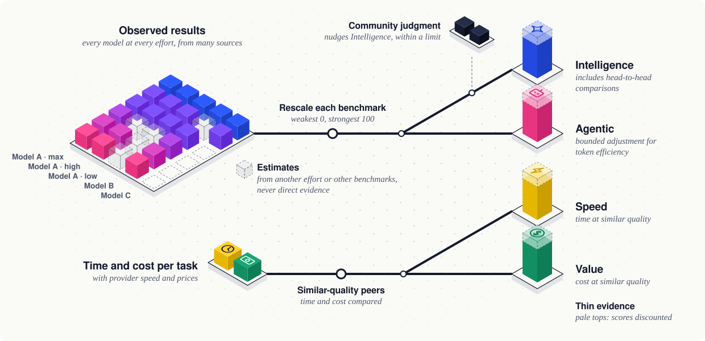
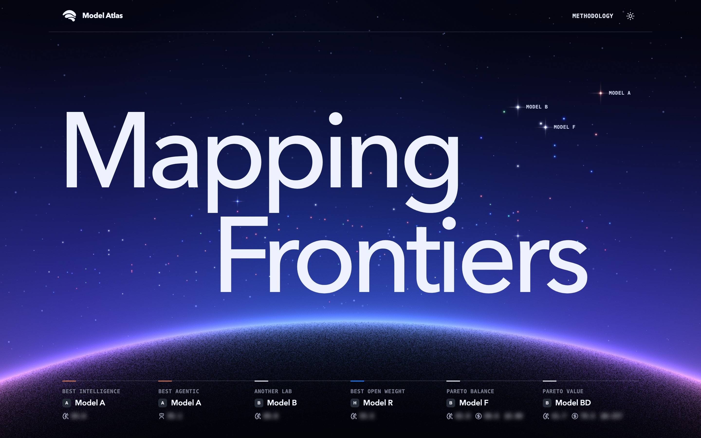
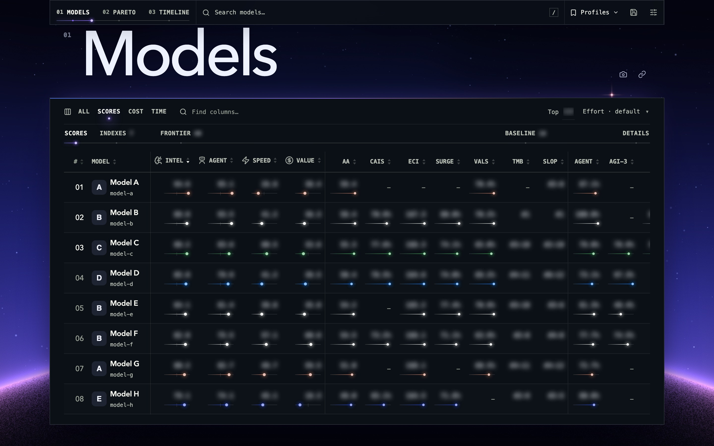
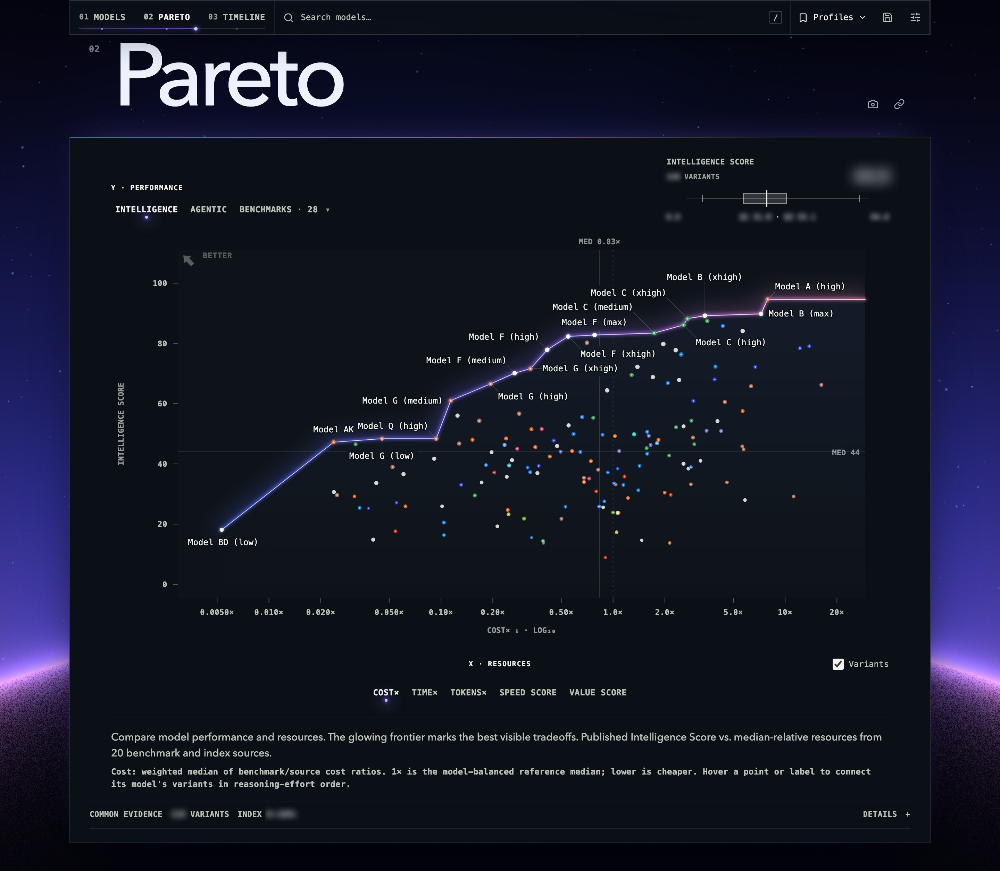
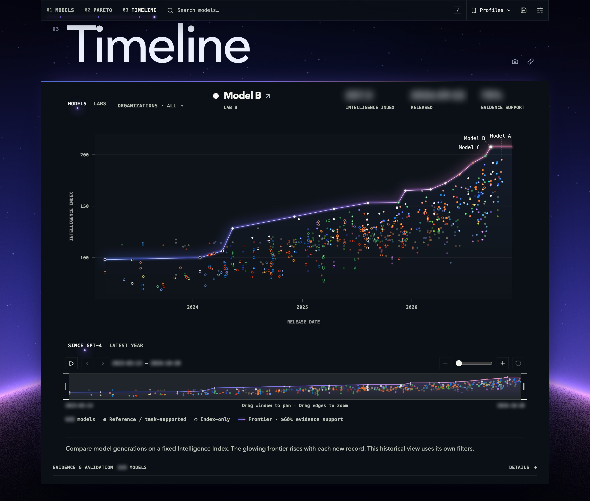

# Model Atlas

Model Atlas turns benchmark results, token use, prices, and runtimes into four separate 0–100 scores for language models. Intelligence and Agentic describe capability; Speed and Value describe resource efficiency, responsiveness, and affordability. Its benchmark portfolio favors difficult, consequential tasks with credible grading that still separate current leading models.

See it live at [llmstats.vercel.app](https://llmstats.vercel.app), or read the same data from the public API at `/api/llm-stats`.

| Score | What it measures |
| --- | --- |
| Intelligence | Solving difficult problems using knowledge, perception, understanding, abstract reasoning, and judgment. |
| Agentic | Reliably turning goals and specifications into working results through instruction following, planning, coding, tool use, verification, and recovery. |
| Speed | Completing work quickly at comparable quality, with fast token generation, low first-token latency, and short total response times. |
| Value | Delivering comparable-quality work at lower cost, combining cost per task with token prices assessed for affordability and efficiency at comparable capability. |

Every model is scored separately at each reasoning effort, and each model's weight is shared across its efforts, so reporting more efforts gives it no extra say. Sources cover different models, and labs publish only some efforts. A missing result is [estimated from another effort of the same model](docs/methodology/imputation.md#imputation-across-reasoning-efforts), shifted by their gap on shared benchmarks, or from the model's standing on its other benchmarks when held-out tests show that prediction works. Estimates shape scores but never count as direct evidence: a model is listed only once enough of its benchmark results are observed.

Scores are relative: each benchmark maps its weakest observed result to 0 and its strongest to 100, so 100 means the strongest current result, not perfect task completion. Intelligence also draws on head-to-head comparisons on the benchmarks each pair of models shares, and Agentic gives a bounded bonus for using fewer tokens than expected at that quality, or a penalty for using more. Speed and Value compare time and cost per task with [models of similar quality](docs/methodology/speed-value.md#similar-quality-peers), so a cheap model that achieves less does not win Value. All four scores are discounted where evidence is thin, and the [Trust Me Bro and Slop Indexes](docs/methodology/intelligence-agentic.md#trust-me-bro-and-slop-indexes) nudge Intelligence, within a small limit, where community experience contradicts the benchmarks.

The [methodology](docs/methodology/overview.md) explains how the scores are calculated, and the [benchmark portfolio](docs/benchmarks.md) lists the benchmarks behind them.

