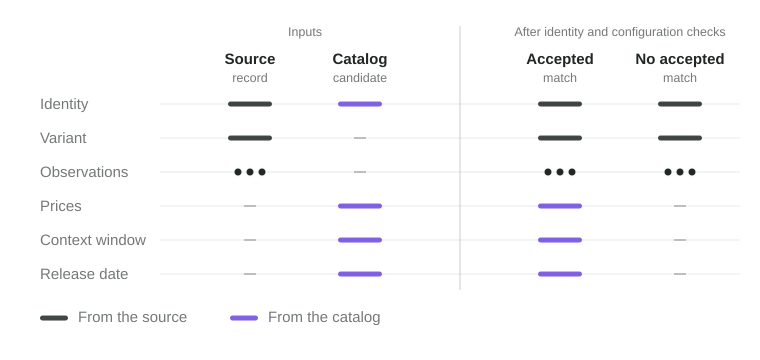
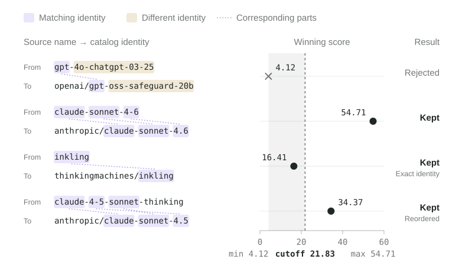

# Model Matching

The same model appears under different names on benchmark pages, catalogs, and serving platforms. Model Atlas joins those records so that results, specifications, prices, and speed measurements describe the same [base model and variant](methodology/overview.md#key-terms).

A mistaken join gives one model another model's evidence. The matcher therefore leaves an uncertain association unmatched.

## Identity Sources

Records join in two ways. Each Artificial Analysis model goes through the scored match on this page, which pairs it with a catalog entry. For the leaderboard, Artificial Analysis is the only source matched this way, so its model list and the catalog together define the identities. Results from every other benchmark source then attach to those models by name, without a score.

The catalog is `models.dev`, limited to its OpenRouter, Vercel, OpenAI, Google, and Anthropic listings and to entries released in the last 365 days, plus older entries for models Artificial Analysis still lists. A listing is one provider's section of the catalog, and an entry is one model in a listing. Where several listings carry an entry with the same model ID, one entry is kept: OpenRouter's, then Vercel's, then the lab's own. This order settles identical IDs only, and gives no listing an advantage when entries with different IDs are [ranked](#candidate-pool).

Matching reads names: the source's model slug, which is the Artificial Analysis ID without its publisher prefix, and each candidate's model ID and display name. Publisher and release only decide which candidates are [eligible](#candidate-pool). Benchmark results and prices never influence a match, nor does a source's general launch date, which does not say which snapshot was evaluated.

A row from another benchmark source attaches when its model name normalizes to one of the model's IDs or names, or reduces to the same [tokens](#normalization), at the variant's reasoning effort or as its [source default](methodology/sources.md#the-source-default-variant). A matched model's names include the one Artificial Analysis gives it, because other sources often use that shorter name instead of the catalog's, such as `Nemotron 3 Ultra` for `Nemotron 3 Ultra 550B A55B`. That name is left out when the matcher passed over a different catalog model of the same name, as when Artificial Analysis calls a preview by its release's name, so the preview never takes the release's results.

A benchmark model can exist before any catalog lists it. An Artificial Analysis model without an accepted catalog match is kept when its ID has the form `publisher/model` and it has a name. Every kept model, matched or not, must list text output and have no `image` in its ID, OpenRouter ID, name, or catalog family. Keeping an identity does not place it on the dashboard: [dashboard inclusion](methodology/leaderboard-rules.md#dashboard-inclusion) is decided from observed results.

## Normalization

Normalization removes spelling differences without erasing version or size distinctions. Names are lowercased; dots, underscores, colons, and spaces become hyphens; a `+` becomes the word `plus`; other punctuation is dropped; and repeated hyphens collapse.

The normalized name is split into tokens at hyphens and wherever a letter meets a digit, so `qwen3` and `qwen-3` compare equal. Parameter scales such as `70b` and active-parameter scales such as `a22b` stay whole, and a full or abbreviated month label followed by a year becomes the same tokens. Labels that describe how a model is served or configured are dropped: `free`, `extended`, `exacto`, `instruct`, `thinking`, `reasoning`, `preview`, `online`, and `nitro`.

A reasoning effort at the end of the source slug, from `none` to `max` and `ultra`, is removed before matching, because it names a variant and not a model. The words `max` and `ultra` are removed even when a product uses one as a tier name, so such a product is matched without it. The one exception is Qwen's Max tier, which stays part of the name.

## Candidate Pool

Eligibility is settled before names are compared, so a convincing name cannot override a conflicting publisher or release.

The source's publisher is the namespace of its ID. A candidate's publisher is the namespace of its model ID, or the listing it came from when the ID has none. OpenRouter and Vercel are gateways, so neither names a publisher, and organization aliases are reconciled first, so Qwen counts as Alibaba. A candidate is excluded when both publishers are known and differ; when either is unknown, the check passes.

A source names a release when its slug carries a full date with a year, or when its display name carries a month and year. The candidate must then carry the same release in its model ID, in its display name, or, failing both, in the catalog's release date; a candidate with none of these is excluded. A month compares at month precision, and two full dates may differ by one day, because sources sometimes report adjacent dates for one launch. A suffix without a year, such as `0528`, names no release, and a source that names none skips this check. An undated Artificial Analysis slug is matched under a dated name when the catalog and a second source agree on one dated release, as [Updated Releases](methodology/sources.md#updated-releases) describes.

A candidate is also dropped unless its model ID, after any namespace, or its display name starts with the source's first token, since a different first token usually means a different family. When no candidate remains and the slug starts with its own publisher's name, as `tencent-hy4` does, the slug is matched again without that word. A slug whose catalog ID also starts with the publisher's name, such as `deepseek-v3`, finds its candidates on the first pass and is never shortened.

The remaining candidates from every listing are ranked together by [candidate score](#candidate-score), with ties broken alphabetically by model ID, and only the five highest are kept. The [Intelligence Index](timeline/overview.md) joins model names across its sources with the same rules.

## Candidate Score

The score orders eligible candidates. It is a heuristic sum of agreements and conflicts between names, not a probability that a match is correct.

Some conflicts reject a candidate outright, whatever else agrees:

- a Claude tier or version that differs from the source's, as [Claude Identity](#claude-identity) explains
- `vl` or `coder` on one side only, or `small` on one side and `micro` on the other
- a number in the candidate's model ID that differs from the source's number at the same position, counting numbers in order of appearance, unless the display name carries numbers that agree at every shared position
- numbers in the model ID that are only the leading part of the source's, or the reverse, so `3` does not match `3.5`, unless the display name carries exactly the source's numbers
- no shared leading characters
- a parameter scale in the source that the candidate lacks or contradicts
- a total score of zero or less

The remaining candidates collect points from every row of the table that applies:

| Comparison | Points |
| --- | --- |
| Leading tokens equal, in order, up to the first difference | 10, 8, 6, 4, and 2 for the first to the fifth token, added together |
| Claude tier and version equal | +20 |
| The source has at least two tokens and no number, and the candidate is the source's name followed only by numbers | +6 |
| The candidate has exactly the source's set of tokens | +4 |
| Source tokens missing from the candidate | −2 for one missing token, and −1 more for each further one |
| Parameter scale equal | +3 |
| Active-parameter scale equal, or different | +2, or −2 |
| First number at a shared token position equal | +2 |
| Last token equal, when it is not a number | +2 |

Three smaller terms separate close candidates: 0.03 points per shared leading character, up to 0.2 points for how closely the numbers agree, and a penalty of 0.005 points per character of difference in length. Token comparisons take the better of the candidate's model ID and display name, a scale is read from the model ID first, and the number and length terms read the model ID only.

## Variant Guardrail

Similar names can identify different products, such as `flash` and `flash-lite`. These product variants are separate models, unlike the reasoning-effort variants of one base model. The guardrail compares a fixed set of product labels: `flash-lite`, `flash`, `pro`, `nano`, `mini`, `lite`, `max`, `image`, `vl`, `coder`, `small`, `micro`, `codex`, `omni`, `multi-agent`, and `latest`. A candidate is rejected when any label appears on one side only. Compound labels are read first, so `flash-lite` does not count as `flash`. Labels are read from the source slug and the candidate's model ID, never from a display name.

The check runs down the five kept candidates in score order and takes the first that passes. When none of the five passes, the source row is unmatched, even if a compatible candidate ranked lower.

The guardrail repeats some labels from the outright rejections in [Candidate Score](#candidate-score) but is stricter. Those rejections read a candidate's model ID and display name together and reject only `small` against `micro`. The guardrail requires a `vl` or `coder` label in the model ID itself, and rejects `small` or `micro` on one side only.

The source slug reaches the guardrail with its trailing reasoning effort already [removed](#normalization), so a `max` at its end is not read as a product label, and a candidate whose model ID carries `max` is rejected for that source. Qwen's Max tier keeps its `max` and is compared as a label.

## Relative Cutoff

The best candidate can still be a poor match. Once each source row has its winner, the matcher rejects winners that score low relative to the batch. A batch is every Artificial Analysis model matched in one refresh. With $S_{\min}$ and $S_{\max}$ as the lowest and highest winning scores in the batch, the cutoff is

$$
S^{\text{cut}}=S_{\min}+0.35\,(S_{\max}-S_{\min}).
$$

A winner below $S^{\text{cut}}$ is rejected unless it is an exact identity: the source slug and the candidate's model ID or display name reduce to the same tokens. The factor $0.35$ is a fixed policy choice: it is not a confidence level, and it does not reject 35% of rows. Rows without a winner do not enter the range, and the cutoff moves when the batch of sources or the catalog changes.

The illustration shows one batch scored without the publisher and release checks, which isolates the cutoff. It does not measure the matcher's accuracy.

The lowest winner shares only the `gpt` prefix with its candidate and is rejected. The reordered Sonnet name is not an exact identity, so it is kept only because its score clears the cutoff.

## Benchmark-Update Health

Benchmark-update health is a separate check that reports, for each benchmark source row, whether a published model represents it. It reuses the [candidate score](#candidate-score) and the [variant guardrail](#variant-guardrail). It requires every source token to appear together in the candidate's model ID or in its display name, except `preview`, `ultra`, `adaptive`, `non`, and the effort words `max`, `xhigh`, `high`, `medium`, `low`, and `minimal`. It applies no publisher or release check, no five-candidate limit, and no relative cutoff.

## Claude Identity

Anthropic has changed the order of tier and version in Claude names, so the matcher reads them as a pair wherever they sit. `Claude 3 Opus`, `claude-3-opus`, and `Claude Opus 3` name one identity, and `claude-35-sonnet` reads as Sonnet 3.5. The tiers are `haiku`, `sonnet`, `opus`, and `fable`.

When both the source and a candidate name a tier and version, the pair must be equal. An equal pair earns the largest single reward and waives the number conflict rules, which a dated name or the `35` spelling would otherwise trip. A different pair rejects the candidate, so a source row whose tier has no candidate stays unmatched instead of borrowing another tier. A candidate that names no tier and version is scored by the ordinary rules.

## Selected Identity

An accepted match takes the winning candidate's model ID as its identity and that entry's `models.dev` record as its metadata: name, release date, reasoning flag, open-weights flag, modalities, token prices, and limits. An unmatched Artificial Analysis identity keeps only what Artificial Analysis reported, which is its release date, modalities, reasoning flag, token prices, throughput, and latency, so its context and output limits stay unknown. A per-model correction overrides the open-weights flag where the publisher's own release contradicts the source.

### Dated Releases

A lab can update a model under an unchanged name, and Artificial Analysis then keeps listing it under its undated ID. The matcher then looks for the dated release instead of the undated name when two kinds of evidence name the same release. First, the catalog lists exactly one model ID that is the undated ID followed by a date, with or without a year. Second, either Artificial Analysis's display name for the model or a Vals model ID names that same dated release. If the catalog lists several dated IDs for the name, or the Artificial Analysis and Vals evidence names more than one, the undated ID is left as it is. A model matched this way keeps the dated ID as its identity even when its display name shows no date. Only a date counts here: a new version number makes a separate model, not an update of the old one. [Updated Releases](methodology/sources.md#updated-releases) explains which benchmark results such a model keeps.

### OpenRouter Routes

A route is one OpenRouter model ID, written `publisher/model`, and one model can have several, such as a dated route, a preview route, and a `:free` route. Routes that serve the same model share one identity, and each identity has one public ID. It identifies the model in the table and the API, and OpenRouter speed measurements and listed route prices attach through it, for matched and unmatched identities alike.

The public ID is the model ID with these parts removed: the `:free` marker, a `fast`, `reasoning`, or `non-reasoning-low-effort` alias, an eight-digit date, a dated preview suffix, and a reasoning-effort suffix. A single-digit version written `4-5` becomes `4.5`. When the catalog entries sharing an identity include one from the OpenRouter listing, that entry's ID, rewritten the same way, supplies the public ID. An unmatched identity's public ID is derived from its Artificial Analysis ID by the same rewriting.

An identity's candidate routes are the route with exactly its public ID and up to eight others from the same publisher that name the same model. Another route names the same model when its name differs only by a dated, preview, beta, or experimental suffix or, for Claude, names the same tier and version. Where more than eight qualify, the first eight in alphabetical order are taken. Among candidates with speed measurements, the one with the most weekly tokens supplies speed, and prices come from it or, when it lists none, from the most-used candidate that does.

When none of those routes exists, a few declared aliases cover routes that OpenRouter names differently. Otherwise the names are reconciled for publisher aliases, a repeated publisher prefix, version spelling, and instruction-tuning labels, and a route is taken only when exactly one remains. OpenRouter also gives each route a permanent ID, which can carry the route's release date. In this step, a model ID that ends in a month and day, such as `0528`, matches an undated route only when that route's permanent ID ends with the same month and day.

### Resource Fields

Each resource field is filled separately. Catalog token prices come first, and Artificial Analysis prices fill only the fields the catalog lacks. A catalog entry priced at zero for both input and output is a free listing rather than the model's price, so Artificial Analysis's paid prices replace it when Artificial Analysis lists them. The prices listed by the provider endpoints of the selected OpenRouter route, combined as the price most of their served tokens pay, are stored as separate weighted prices that feed the [blended token price](methodology/speed-value.md#blended-token-price); they never overwrite the catalog prices. Throughput and latency come from OpenRouter, and Artificial Analysis measurements for the same variant fill only the fields OpenRouter lacks. Artificial Analysis's cost of running a benchmark is never read as a token price.

### Reasoning Efforts

Each reasoning effort a source reports stays a separate variant under the shared identity. The effort comes from the source's effort field where the source has one. Artificial Analysis falls back to an effort label in the model's name when that field is empty, and sources without an effort field read the label from the name. A row with neither has no reasoning effort. [The Source-Default Variant](methodology/sources.md#the-source-default-variant) explains which observation represents a model whose source names no reasoning effort, and [Collapsed and Expanded Rows](methodology/leaderboard-rules.md#collapsed-and-expanded-rows) explains how the table shows a base model's variants.
