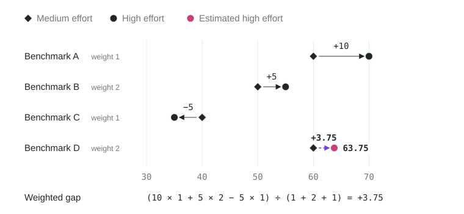
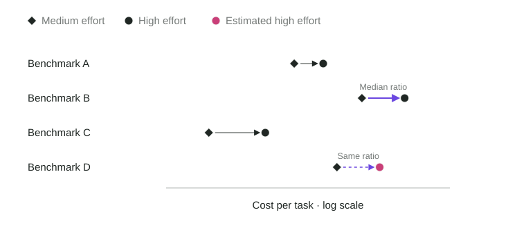
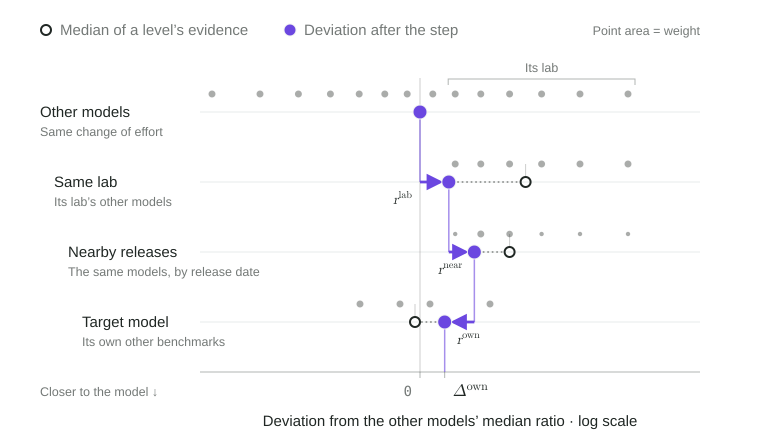
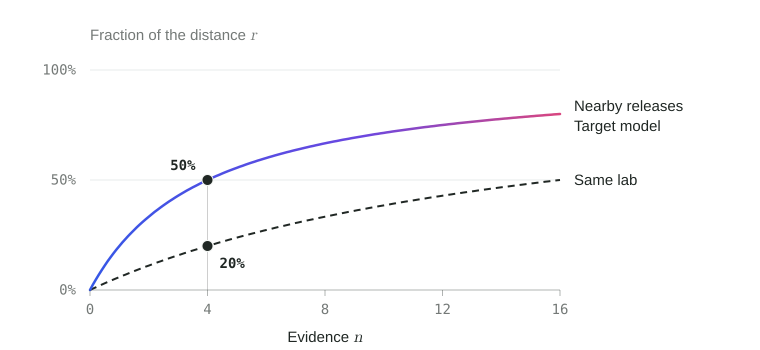

# Imputation

Benchmark and resource coverage is uneven: sources report different models, and labs publish some reasoning efforts but not others. Imputation estimates a missing value from observed ones, so that a gap in coverage does not decide a score by itself. An estimate is never treated as an observation.

## What Estimates Can and Cannot Do

Four kinds of estimate fill a missing benchmark result or resource amount, and each is allowed a different role. An index result reported for a model as a whole reaches its other efforts by a separate rule, [Indexes Across Reasoning Efforts](intelligence-agentic.md#indexes-across-reasoning-efforts). The roles refer to separate parts of a score. For :score[Intelligence] and :score[Agentic], the [benchmark mean](intelligence-agentic.md#weights-and-the-benchmark-mean) is the weighted mean of a variant's benchmark scores and is the basis of the score, [evidence support](intelligence-agentic.md#evidence-support) is the share of the benchmark portfolio that the variant's results back, and [score retention](intelligence-agentic.md#score-retention) is the discount on a score backed by little benchmark weight. For :score[Speed] and :score[Value], a discounted resource input counts at less than its full weight, by an [evidence factor](speed-value.md#evidence-factors) below 1.

| Estimate | What it is built from | Role in scoring |
| --- | --- | --- |
| Benchmark result across reasoning efforts | The same model's observed result on that benchmark at another effort | Fills the missing contribution to the benchmark mean. Adds no evidence support of its own; an estimate from other benchmarks for the same benchmark still supplies its evidence factor. |
| Benchmark result from other benchmarks | The variant's standing on its other benchmarks | Supplies quality for resource comparisons and discounted evidence support. Does not enter the benchmark mean. |
| Resource across reasoning efforts | The same model's observed resource at another effort | Supplies a discounted resource input. |
| Resource from broader evidence | How other models' resources change between the same two efforts | Supplies a discounted resource input, only when no ratio from the model's own measurements is accepted. |

The first two differ for a reason. An estimate carried across efforts starts from the same model's observed result on the missing benchmark, so it brings new information about that benchmark and can stand in the benchmark mean. It adds no evidence support, so filling a gap this way changes the score without making the variant count as better covered. An estimate from other benchmarks is derived from the variant's performance elsewhere; putting it in the mean would count the same performance twice. Its held-out validation does show how predictable the missing result is, and that earns partial evidence support. These roles are scoring-policy choices; validation alone does not dictate them.

Every estimate obeys the same limits. It never sets a reference scale, a peer population, or a score limit, and never counts toward [dashboard inclusion](leaderboard-rules.md#dashboard-inclusion) or [resource score availability](leaderboard-rules.md#resource-score-availability). An observed result or an accepted [source crosswalk](sources.md#source-crosswalks) always takes precedence, and a benchmark contributes at most once to a variant's benchmark mean.

A source crosswalk is not imputation. It combines observed results from comparable sources of one benchmark and counts as a benchmark result in full.

## Benchmark Results Across Reasoning Efforts

A missing benchmark score is estimated from the same model's observed score at another reasoning effort, shifted by how far apart the two efforts are on the benchmarks both have. The effort with the gap is the target effort; the effort that supplies the observed result is the reference effort. The estimate assumes the gap measured on shared benchmarks carries over to the missing one. It does not assume that a higher effort performs better: the direction follows the observations.

The calculation runs separately for :score[Intelligence] and for [token-adjusted :score[Agentic]](intelligence-agentic.md#agentic-token-efficiency). It uses frontier benchmarks only, each as one score however many questions it contains, with $\omega_b$ the benchmark's [base weight](intelligence-agentic.md#weights-and-the-benchmark-mean) in the capability being calculated. Aggregate indexes, baseline benchmarks, and other estimates take no part, and gaps are measured before any missing result is filled. A variant without a named reasoning effort neither receives nor supplies these estimates, and an [updated release](sources.md#updated-releases) receives none.

### Choosing the Reference Effort

A reference effort must have an observed result for the missing benchmark and at least three benchmarks observed at both efforts. Among several candidates, the one whose shared benchmarks have the largest [effective count](operations.md#effective-count) by base weight is chosen, so the gap rests on broad overlap instead of one heavily weighted benchmark.

Ties go to the reasoning effort closest to the target, then to a fixed label order. Without a qualifying effort, the result stays missing.

### Estimating the Score

For each shared benchmark $b'$, $z^{\text{target}}_{b'}$ and $z^{\text{ref}}_{b'}$ are the two efforts' benchmark scores. The gap $\Delta$ is the [weighted mean](operations.md#weighted-mean) of their differences. Adding it to the reference effort's score on the missing benchmark $b$, $z^{\text{ref}}_b$, gives the estimate, [clamped](operations.md#linear-scaling-and-clamping) to 0–100:

$$
\begin{aligned}
\Delta&=\frac{\sum_{b'}\omega_{b'}\,(z^{\text{target}}_{b'}-z^{\text{ref}}_{b'})}{\sum_{b'}\omega_{b'}},\\
\hat z^{\text{target}}_b&=\operatorname{clamp}_{0}^{100}(z^{\text{ref}}_b+\Delta).
\end{aligned}
$$

A result can be filled even when the variant already has enough evidence for full score retention.

## Benchmark Results from Other Benchmarks

This estimate finds the variant's standing on its other benchmarks among variants that have the missing benchmark, then reads the missing benchmark's value at the same standing. The assumption is that relative standing on other benchmarks predicts standing on the missing one, and it is tested before any estimate is used.

Its targets are the frontier benchmarks and aggregate indexes a variant lacks. The estimate is made separately for Intelligence and Agentic, because each capability has its own set of other benchmarks and its own weights. A benchmark allocated to both capabilities therefore gets two estimates, which combine into one value as a weighted mean by the benchmark's allocation. When only one capability yields an estimate, that estimate stands alone. The steps below describe the calculation within one capability.

### Mean of the Other Benchmarks

The variant's other observed results are summarized by their [weighted mean](operations.md#weighted-mean) $\bar z^{\text{other}}$. Each benchmark's score $z_b$ is its [normalized result](intelligence-agentic.md#benchmark-scores), without the token adjustment, and its weight $\omega_b$ is its allocation to the capability. For a frontier benchmark or an index this is its [base weight](intelligence-agentic.md#weights-and-the-benchmark-mean); a baseline benchmark has an allocation as well and is weighted by it here:

$$
\bar z^{\text{other}}=\frac{\sum_b\omega_b\,z_b}{\sum_b\omega_b}.
$$

The mean draws on frontier benchmarks, baseline benchmarks, and aggregate indexes alike, each index counting as one entry, so baseline results help predict a missing frontier result even though they carry no weight in a capability score. The missing benchmark and every estimate are left out, and at least three other observed benchmarks are required.

### Standing Among Reference Variants

The reference variants are those with an observed result on the missing benchmark and a mean of other benchmarks calculated the same way. They must cover at least three base models. Each reference variant carries its [reference weight](overview.md#reference-weight), so a base model with five eligible efforts has no more say than a model with one.

The variant's standing $r$ is the [weightedQuantileRank](operations.md#weighted-ranks) of its mean among the reference variants' means, as a fraction:

$$
r=\operatorname{weightedQuantileRank}(\bar z^{\text{other}})/100.
$$

### Value at That Standing

The estimate $\hat x$ is the [weightedQuantile](operations.md#weighted-median-and-quantiles) at fraction $r$ of the same reference variants' observed results on the missing benchmark, with the same reference weights:

$$
\hat x=\operatorname{weightedQuantile}(r).
$$

### Validation

Each base model is withheld in turn, with all its efforts, and its observed results on the benchmark are predicted from the rest. The method is accepted for a benchmark only when at least four withheld base models yield predictions and their model-balanced median absolute error is at most 25 points on the normalized scale.

An accepted estimate's [evidence factor](intelligence-agentic.md#evidence-support-and-score-retention) is set by its prediction error and by the share of the variant's other benchmarks that are observed. For a benchmark, the factor counts toward evidence support and score retention, and it discounts the resource comparisons that use the estimate as quality. An estimated aggregate index adds evidence support but no weight toward retention: [score retention](intelligence-agentic.md#score-retention) counts an index by the number of benchmarks it stands for, and only an observed index has that count.

## Resources Across Reasoning Efforts

A missing cost, runtime, or token amount is estimated from the same model's observed amount at another reasoning effort, multiplied by the typical ratio between the two efforts on the benchmarks where both are measured. The estimate assumes that ratio is stable across benchmarks. Held-out validation checks whether the model's own measurements support the assumption.

Cost, runtime, total tokens, and output tokens each have their own ratios. Cost and runtime per task feed :score[Value] and :score[Speed]. Total and output tokens feed the [token-efficiency adjustment](intelligence-agentic.md#agentic-token-efficiency) of :score[Agentic]. Output tokens, divided by served throughput, also give a runtime where a benchmark reports none, as in [Resources per Task](speed-value.md#resources-per-task), and runtime here includes that derived time.

The amounts are those of individual benchmarks. An aggregate index's cost and runtime are averages across its benchmarks, so they are excluded. The one index amount that takes part is the Artificial Analysis Intelligence Index's tokens per task, which count as one paired entry among the token ratios. Variants without a named reasoning effort take no part.

### Estimating the Effort Ratio

The reference effort is another effort of the same model that has the amount on the missing benchmark and a ratio that passes the check in the next section. Among several, the effort nearest the target is preferred, and the higher evidence factor breaks ties.

For a resource observed on benchmark $b'$ at both efforts, $\rho_{b'}=R^{\text{target}}_{b'}/R^{\text{ref}}_{b'}$ is the ratio of the target effort's amount to the reference effort's. At least three benchmarks with both amounts are required. The ratio applied is the [median](operations.md#weighted-median-and-quantiles) across all of them, taken in logarithms. The estimate for the missing benchmark $b$ multiplies the reference effort's observed amount there, $R^{\text{ref}}_b$, by that ratio:

$$
\hat R^{\text{target}}_b=R^{\text{ref}}_b\exp\bigl(\operatorname{median}_{b'\ne b}\ln\rho_{b'}\bigr).
$$

### Checking the Errors

A ratio is applied only after it predicts the model's own measurements well enough. Each benchmark with both amounts is withheld in turn and takes the place of $b$ in the formula above, so its target amount is predicted from the median log ratio of the others.

Validation measures both the error in the amount and its effect on the score. For each withheld benchmark, $S^{\text{res}}_b$ and $\hat S^{\text{res}}_b$ are the [resource efficiency scores](speed-value.md#resource-efficiency-score) of the observed and predicted amounts. The two median absolute errors are:

$$
e^{\text{log}}=\operatorname{median}_b\left|\ln\frac{\hat R^{\text{target}}_b}{R^{\text{target}}_b}\right|,
\qquad
e^{\text{score}}=\operatorname{median}_b\left|\hat S^{\text{res}}_b-S^{\text{res}}_b\right|.
$$

The ratio is rejected if the log error reaches $\ln 2$, a factor of two, if the score error reaches 25 points, or if fewer than three withheld scores can be compared. Otherwise the evidence factor $f^{\text{res}}$ is the smaller of the two discounts, each clamped to 0–1:

$$
f^{\text{res}}=\min\left(1-\frac{e^{\text{log}}}{\ln2},\ 1-\frac{e^{\text{score}}}{25}\right).
$$

When the quality the resource is compared at is also an estimate, that estimate's [evidence factor](intelligence-agentic.md#evidence-factors) multiplies $f^{\text{res}}$.

## Resources from Broader Evidence

When a model's own measurements cannot support a ratio, the estimate starts from other models that make the same change of reasoning effort on the same benchmark. It is then moved, one step at a time, toward what is known about the model's lab, its neighbors in release date, and the model itself. Evidence closer to the model is more relevant but scarcer, so each step moves only as far as its evidence supports.

Cost, runtime, total tokens, and output tokens each use their own observations and ratios, and an aggregate index's token estimate starts from other models' tokens on that same index. Runtime from broader evidence requires reported seconds paired with observed quality; time derived from throughput cannot supply it.

### Chain of Steps

Everything is measured in log ratios of the target effort's amount to the reference effort's. For benchmark $b$, $\tilde\rho_b$ is the median ratio across the other base models that have the amount at both efforts, taken in logarithms. A deviation says how far a model's ratios sit from those medians. Each other base model $j$ has one deviation $\Delta_j$: the median, across the benchmarks it measures at both efforts, of its log ratio minus the median log ratio of the remaining models on that benchmark, counting only benchmarks that at least two remaining models measure at both efforts. Each step starts from the value the previous step produced:

> [!FLOW]
>
> 1. **Other models**
>
>    The median ratio $\tilde\rho_b$ for the missing benchmark, across at least two other base models. Every effort of the target model is excluded. The deviation starts at zero.
>
> 2. **Same lab**
>
>    The deviation moves toward $\tilde\Delta^{\text{lab}}$, the median of the deviations $\Delta_j$ of the lab's other models.
>
> 3. **Nearby releases in that lab**
>
>    The deviation moves toward $\tilde\Delta^{\text{near}}$, the weighted median of the same deviations with more weight on models released close to the target model.
>
> 4. **Target model**
>
>    The deviation moves toward $\tilde\Delta^{\text{own}}$, the median of the target model's own log ratio minus $\ln\tilde\rho_{b'}$ across its other benchmarks $b'$.

Each step covers a fraction $r=n/(n+n_{50})$ of the distance to its target, where $n$ is the amount of evidence behind the step and $n_{50}$ the amount at which the step covers half the distance. The last deviation gives the ratio $\hat\rho_b$ applied to the reference effort's observed amount:

$$
\begin{aligned}
\Delta^{\text{lab}}&=r^{\text{lab}}\,\tilde\Delta^{\text{lab}},\\
\Delta^{\text{near}}&=\Delta^{\text{lab}}+r^{\text{near}}\,(\tilde\Delta^{\text{near}}-\Delta^{\text{lab}}),\\
\Delta^{\text{own}}&=\Delta^{\text{near}}+r^{\text{own}}\,(\tilde\Delta^{\text{own}}-\Delta^{\text{near}}),\\
\ln\hat\rho_b&=\ln\tilde\rho_b+\Delta^{\text{own}},\qquad \hat R^{\text{target}}_b=R^{\text{ref}}_b\,\hat\rho_b.
\end{aligned}
$$

### Evidence Behind Each Step

With little evidence the estimate stays close to the result from other models:

| Step | Evidence $n$ | Half-distance amount $n_{50}$ |
| --- | --- | --- |
| Same lab | Number of other base models from the lab that have a deviation | 16 |
| Nearby releases | Sum of the release-date weights of those models | 4 |
| Target model | Number of its other benchmarks measured at both efforts that at least two other base models also measure at both | 4 |

Release proximity uses a Gaussian weight on the difference in release dates $\Delta t$, in days, with a width of 60 days:

$$
\exp\left[-\tfrac12\left(\frac{\Delta t}{60}\right)^2\right].
$$

Earlier and later releases both contribute, and there is no cutoff.

A step without evidence leaves the deviation where the previous step put it. A model without a release date therefore keeps the lab step's value, and a model without a known lab skips both the lab and the release step. The reference effort is the closest effort of the same model that has the amount on the missing benchmark and for which the chain can be computed. A validated ratio from the model's own measurements always takes precedence.

### Evidence Factor

The evidence factor $f^{\text{res}}$ grows with the number $n_b$ of other base models behind the estimate and falls with their disagreement $s_b$, the median absolute difference between their log ratios on the benchmark and the final estimated log ratio $\ln\hat\rho_b$:

$$
f^{\text{res}}=\frac{n_b}{n_b+4}\max\left(0,\ 1-\frac{s_b}{\ln 2}\right).
$$

A zero factor or a non-finite amount leaves the value missing.

## Parameter Choices

These values are scoring-policy choices, not fitted claims about model behavior.

| Parameter | Value | Why it exists |
| --- | ---: | --- |
| Shared benchmarks for an estimate across efforts | 3 | Requires benchmarks observed at both efforts of the same base model; indexes and estimates do not count. |
| Other observed benchmarks required | 3 | Requires a broader basis than one or two results. |
| Reference base models for an estimate from other benchmarks | 3 | Requires the standing to be read against more than one or two models. |
| Withheld base models for estimates from other benchmarks | 4 | Requires independent evidence beyond the minimum reference set. |
| Maximum normalized error | 25 points | Refuses a predictor whose typical held-out error is too large to be useful; the evidence factor reaches zero at this boundary. |
| Paired benchmarks for a resource ratio across efforts | 3 | Prevents one or two benchmarks from defining a ratio between efforts. |
| Resource ratio log-error ceiling | $\ln 2$ | Rejects a ratio whose typical held-out error reaches a factor of two. |
| Resource ratio score-error ceiling | 25 points | Rejects a ratio with large typical errors in resource efficiency scores. |
| Broader evidence: other base models | 2 | Requires the same change of effort on the same benchmark from more than one other model. |
| Broader evidence: release width | 60 days | Gives nearby releases more influence without a hard date cutoff. |
| Broader evidence: evidence-factor half amount | 4 other base models | Counts an estimate backed by few other models at less than half weight. |
| Broader evidence: disagreement ceiling | $\ln 2$ | Gives no evidence once the other models' ratios typically differ from the estimate by a factor of two. |
| Broader evidence: half-distance amounts | 16 for the lab; 4 for nearby releases and the target model | Limits a noisy lab adjustment and discounts sparse ones without tuning per model. |
