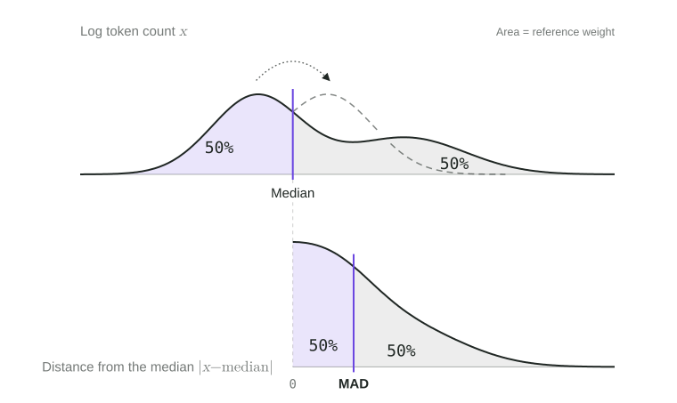
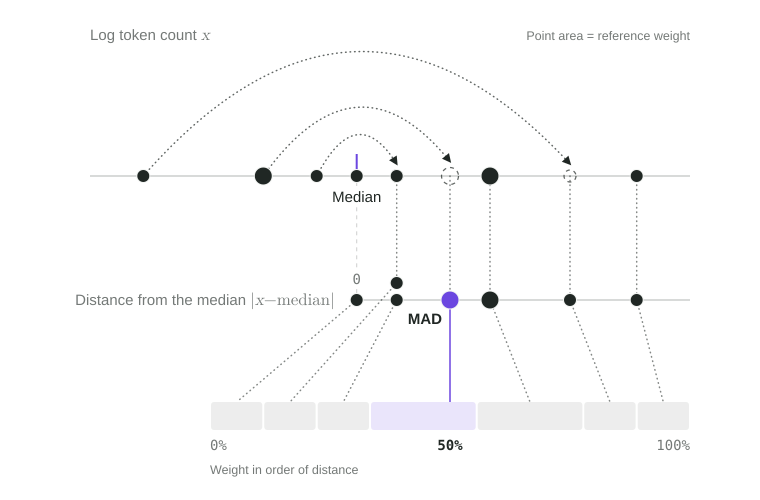
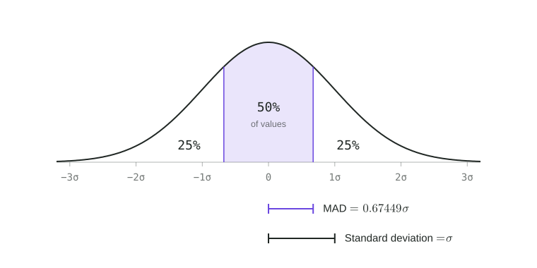
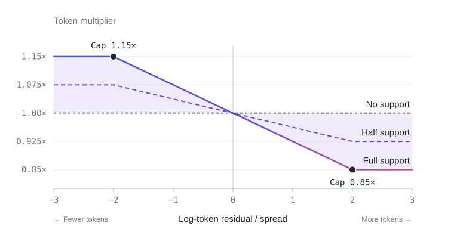
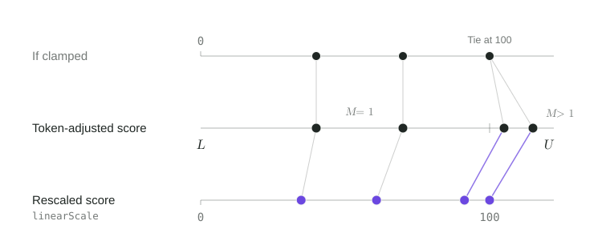
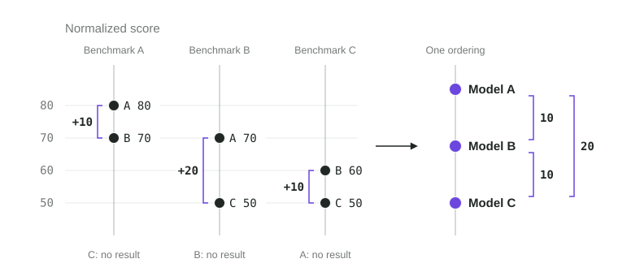
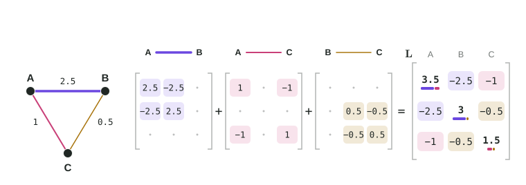
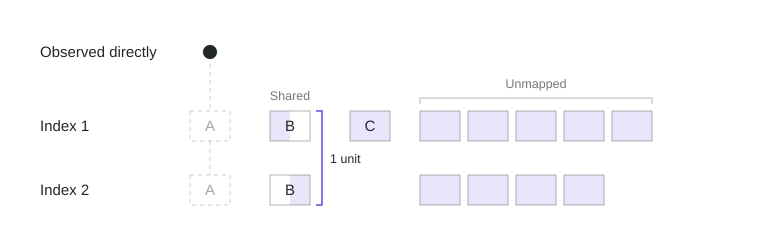
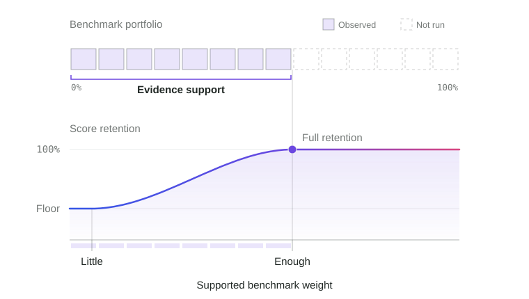
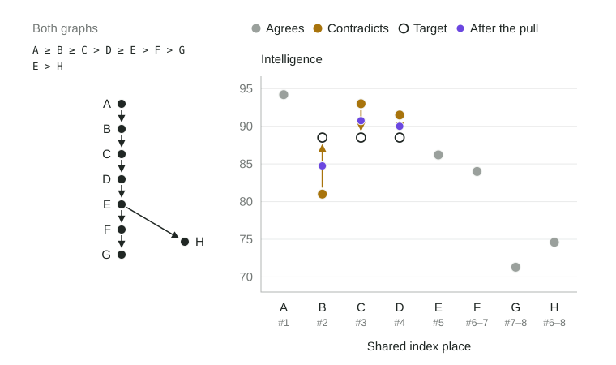

# :score[Intelligence] and :score[Agentic]

:score[Intelligence] and :score[Agentic] turn benchmark results into one capability score per [variant](overview.md#key-terms). Each benchmark is first placed on a common 0–100 scale so results in different units can be combined, and weights decide how much each benchmark counts. :score[Agentic] then adjusts for token efficiency, :score[Intelligence] adds a comparison on shared benchmarks, and both combine with aggregate indexes and discount thin evidence. Prices and runtimes affect neither score. [Imputation](imputation.md) covers results a variant lacks.

## Benchmark Scores

Benchmarks report results in different units and difficulty ranges, so each one is rescaled to 0–100 across the results actually observed: the weakest observed result becomes 0 and the strongest 100.

| Reported form | Interpretation |
| --- | --- |
| Fraction | A result on a 0–1 scale. |
| Percentage or points | Read in the declared units; points need not represent accuracy. |
| Elo rating | A relative rating kept in native units unless a source-specific conversion applies. |

### Normalization

For variant $m$ with reported result $x_{m,b}$ on benchmark $b$, the benchmark score $z_{m,b}$ combines [linear scaling and clamping](operations.md#linear-scaling-and-clamping) to map the observed minimum $x_{\min,b}$ to 0 and the observed maximum $x_{\max,b}$ to 100:

$$
z_{m,b}=100\operatorname{clamp}_{0}^{1}\bigl(\operatorname{linearScale}_{x_{\min,b}}^{x_{\max,b}}(x_{m,b})\bigr).
$$

If all observed results are equal, each receives 100. An estimate is placed on the same observed bounds and clamped to 0–100, without changing those bounds.

### Elo Conversion

Where a source-specific conversion applies, an Elo rating $x$ is first mapped from the chosen endpoints 500 and 2500 onto 0–1, and observed-range normalization follows:

$$
\operatorname{clamp}_{0}^{1}\bigl(\operatorname{linearScale}_{500}^{2500}(x)\bigr).
$$

The endpoints are adopted from Artificial Analysis as a source-specific convention, not universal Elo limits. The [source notes](../benchmarks.md#source-notes) say which benchmarks use the conversion.

## Weights and the Benchmark Mean

A benchmark's weight in a capability comes from its allocation, the split between Intelligence and Agentic: 100/0, 75/25, 50/50, 25/75, or 0/100. Its base weight $\omega_{b,d}$ is its allocation to capability $d$, as a fraction. Only frontier benchmarks carry weight; the [benchmark portfolio](../benchmarks.md#reading-the-portfolio) lists them with their allocations.

The benchmark mean $\bar z_{m,d}$ is the [weighted mean](operations.md#weighted-mean) of a variant's benchmark scores in capability $d$:

$$
\bar z_{m,d}=\frac{\sum_{b}\omega_{b,d}\,z_{m,b}}{\sum_{b}\omega_{b,d}}.
$$

The sums run over the frontier benchmarks with positive weight in the capability for which the variant has a result. A missing result drops out instead of counting as zero, and the remaining weights keep their proportions. A [supported estimate from another reasoning effort](imputation.md#benchmark-results-across-reasoning-efforts) can fill a gap in the mean; an estimate from other benchmarks cannot. For :score[Agentic], the mean uses the token-adjusted score $z^{\text{tok}}_{m,b}$ from the next section in place of $z_{m,b}$.

Every variant uses the same base weights, with one exception: for an [updated release](sources.md#updated-releases), a benchmark or index sourced from Artificial Analysis or Vals carries twice its base weight in the benchmark mean, the combination with indexes, evidence support, and score retention. Comparisons on shared benchmarks keep the base weights.

## :score[Agentic] Token Efficiency

:score[Agentic] rewards reaching comparable benchmark quality with fewer tokens and penalizes needing more. Tokens are an imperfect measure of efficiency, so the adjustment is a multiplier limited to 0.85–1.15 on each benchmark score. It affects benchmark contributions to :score[Agentic] only, not :score[Intelligence] or the reported benchmark results.

### Actual and Expected Token Use

For variant $m$ on benchmark $b$, actual tokens $R_{m,b}$ are compared with expected tokens $\mu_{m,b}$, the amount that models of similar quality use, predicted like [expected cost and time](speed-value.md#expected-resource-use). The log residual $\Delta_{m,b}$ expresses the actual-to-expected ratio:

$$
\Delta_{m,b}=\ln\left(\frac{R_{m,b}}{\mu_{m,b}}\right).
$$

The residual is negative for fewer tokens than expected and positive for more, and the log treats half and twice the expected use symmetrically.

### Comparable Token Measurements

The comparison uses observed quality and observed token counts from other [base models](overview.md#key-terms), before any dashboard filtering. Estimated quality cannot activate the adjustment. Estimated tokens can receive a discounted adjustment but never enter the reference population, the models from which expected use and the spread are calculated.

Token counts must come from the same benchmark and reasoning effort, and only benchmarks whose portfolio entry declares usable resource measurements take part; every other benchmark keeps a multiplier of 1. Total tokens are tried first: a model's input plus output count, or its reported total where the two are not both published. If fewer than three base models supply them, output-only counts are tried on their own. The two measures are never mixed. An aggregate index's token counts belong only to that index.

Where a benchmark has several sources whose token counts [do not agree](sources.md#resources-across-sources), the adjustment is calculated for each source separately, against that source's own quality and token counts, and each source supplies an equal share of it.

### Token-Use Spread

The spread $s_b$ supplies the scale for judging whether a residual is small or large. It is calculated from the log token counts $y_{j,b}=\ln R_{j,b}$ of every variant $j$ with observed quality, weighted by their [reference weights](overview.md#reference-weight) $w^{\text{ref}}_{j,b}$:

$$
\tilde y_b=\operatorname{weightedMedian}_j(y_{j,b};w^{\text{ref}}_{j,b}),\qquad s_b=1.4826\operatorname{weightedMedian}_j\bigl(|y_{j,b}-\tilde y_b|;w^{\text{ref}}_{j,b}\bigr).
$$

The first [weighted median](operations.md#weighted-median-and-quantiles), $\tilde y_b$, finds the center of the log token counts. The second finds the typical absolute distance from that center, the median absolute deviation (MAD). Medians limit the effect of extreme counts. This is the spread of log token counts, not of prediction residuals.

In the illustrations, values equally far below and above the center fold onto the same absolute distance, keeping their weights. Both are illustrative, not measured token data.

The factor 1.4826 puts the MAD on a standard-deviation scale: for a normal distribution with standard deviation $\sigma$, half the values lie within $0.67449\sigma$ of the center, and $1/0.67449\approx1.4826$. This is a statistical convention, not a fitted parameter: log token counts need not be normally distributed, and the scaled MAD then need not equal their standard deviation.

### Token Multiplier

The token multiplier $M^{\text{tok}}_{m,b}$ is above 1 for a bonus, below 1 for a penalty, and 1 for no adjustment. The adjustment grows in proportion to the distance between actual and expected use, measured in spread units: fewer tokens than expected raise the multiplier, and more lower it. It reaches its limit at two spread units, beyond which more extreme token use changes nothing. [Peer support](speed-value.md#peer-support) $p_{m,b}$ scales it by how well similar-quality models support the comparison, so a comparison against few or distant models cannot move the score much:

$$
M^{\text{tok}}_{m,b}=1-0.15\,p_{m,b}\operatorname{clamp}_{-1}^{1}\left(\frac{\Delta_{m,b}}{2s_b}\right).
$$

The multiplier stays at 1 when tokens are neither observed nor estimable, the spread $s_b$ is zero, benchmark quality has no observed variation, peer support is zero, or fewer than three base models report either token measure.

For estimated tokens, the estimate's evidence factor $f^{\text{res}}$ shrinks the bonus or penalty in proportion to the support for the estimate, separately from peer support:

$$
M^{\text{tok}}_{m,b}\leftarrow1+f^{\text{res}}\left(M^{\text{tok}}_{m,b}-1\right).
$$

The arrow replaces the multiplier with the discounted one. Observed tokens skip this step. Token estimates and their evidence factors come from the same [effort ratios](imputation.md#resources-across-reasoning-efforts) and [broader evidence](imputation.md#resources-from-broader-evidence), as for cost and time, separately for total and output-only tokens.

### Rescaling Adjusted Scores

Multiplying can push a strong result above 100. Clamping would erase the difference between results pushed past it, so the benchmark's scores are rescaled instead whenever an adjusted score with observed tokens falls outside 0–100. The bounds $L_b$ and $U_b$ come from those observed adjusted scores $z'_{j,b}$:

$$
\begin{aligned}
z'_{m,b}&=z_{m,b}M^{\text{tok}}_{m,b},\\
L_b&=\min(0,\min_jz'_{j,b}),\qquad U_b=\max(100,\max_jz'_{j,b}),\\
z^{\text{tok}}_{m,b}&=100\operatorname{linearScale}_{L_b}^{U_b}(z'_{m,b}).
\end{aligned}
$$

The token-adjusted score $z^{\text{tok}}_{m,b}$ enters the :score[Agentic] benchmark mean and the [estimates across reasoning efforts](imputation.md#benchmark-results-across-reasoning-efforts). Rescaling can also move scores whose multiplier is 1, so the ±15% limit applies to the multiplier, not to the final change in a score. A score adjusted with estimated tokens does not set the bounds and is clamped to 0–100 after rescaling.

Evidence weights and inclusion requirements are unaffected. :score[Value] can change indirectly, because it uses :score[Agentic] as part of its quality reference. Token counts alone cannot distinguish success from early termination or establish that a reasoning effort caused an efficiency gain.

## Shared-Benchmark Comparisons for :score[Intelligence]

Two models can earn similar benchmark means from different sets of benchmarks. The shared-benchmark comparison checks each pair of models on the frontier benchmarks both actually report, then fits those comparisons together into one order. That order supplies 20% of the blended benchmark score; the benchmark mean supplies 80%.

### Comparing Shared Observations

Each Intelligence benchmark contributes its benchmark score $z_{m,b}$, so a wide gap counts for more than a narrow one. Accepted [source crosswalks](sources.md#source-crosswalks) count as benchmark results. Aggregate indexes and estimates do not enter. A missing observation creates no comparison and does not count as a loss.

Only variants of different base models are compared. With $n_b$ base models reporting benchmark $b$, the comparison between variants $m$ and $j$ on that benchmark has weight:

$$
\lambda_{m,j,b}=\frac{\omega_{b,I}\,w^{\text{ref}}_{m,b}\,w^{\text{ref}}_{j,b}}{n_b-1}.
$$

Here $\omega_{b,I}$ is the benchmark's Intelligence base weight and $w^{\text{ref}}_{m,b}$ the variant's [reference weight](overview.md#reference-weight). Summed over its comparisons, each base model receives one benchmark weight however many reasoning efforts it reports. A benchmark reported by fewer than two base models supplies no comparison; its contribution to the benchmark mean remains.

### Fitting the Comparison Graph

Each variant is a node, and each shared frontier benchmark supplies a weighted edge between two variants. The fit covers the largest connected component: the largest group of variants linked to one another, directly or through other variants, by shared benchmarks. A variant outside that group keeps its benchmark mean unblended, because separate groups share no rating origin. One rating $\theta_m$ per variant is fitted by minimizing disagreement with the observed score differences:

$$
\underset{\theta}{\operatorname{minimize}}\sum_{b}\sum_{m<j}\lambda_{m,j,b}\left[(\theta_m-\theta_j)-(z_{m,b}-z_{j,b})\right]^2.
$$

The comparisons need not agree: A may beat B, B may beat C, and C may beat A on different shared benchmarks. Least squares finds a compromise, with larger edge weights making disagreement more costly. It does not guarantee that every direct winner ranks higher overall.

The illustration shows three models from a larger normalization population; the models that define each benchmark's 0 and 100 are omitted. The observed gaps conflict: the A–B and B–C gaps add up to less than the A–C gap. With equal weights, least squares spreads that disagreement across all three comparisons, so no fitted gap matches its observation exactly.

### What the Laplacian Does

The fit is solved with a graph Laplacian, a table of coefficients for calculating weighted rating differences. Writing out Model A's comparisons with B and C shows why the diagonal is positive and the other entries are negative.

In the illustration, A's comparison with B has weight 2.5 and its comparison with C has weight 1. With A, B, and C standing for the ratings, the two weighted differences add up to:

$$
\begin{aligned}
2.5(A-B)+1(A-C)
&=2.5A-2.5B+A-C\\
&=3.5A-2.5B-1C.
\end{aligned}
$$

The matrix stores those coefficients in columns A, B, and C: **[3.5, −2.5, −1]**. The positive 3.5 combines the two own-rating terms, and the negative coefficients subtract the neighbors' ratings. They do not say who won, and the positive diagonal does not mean A beat itself.

The other rows follow the same recipe:

| Model's row | Weighted comparisons | Coefficients in columns A, B, C |
| --- | --- | --- |
| A | $2.5(A-B)+1(A-C)$ | $[3.5,-2.5,-1]$ |
| B | $2.5(B-A)+0.5(B-C)$ | $[-2.5,3,-0.5]$ |
| C | $1(C-A)+0.5(C-B)$ | $[-1,-0.5,1.5]$ |

If all three ratings are equal, each weighted difference is zero. Each row's positive coefficient therefore balances its negative ones: the calculation measures relative gaps, not the absolute rating level.

The least-squares fit is at its minimum when moving any one rating can no longer reduce the disagreement. For Model A, that holds when its weighted fitted differences equal its weighted observed differences:

$$
2.5(A-B)+1(A-C)=2.5\,\Delta z_{AB}+1\,\Delta z_{AC},
$$

where $\Delta z_{AB}$ is A's score minus B's on the benchmark they share. The left side is A's row of coefficients applied to the ratings, and the right side is a single number, $h_A$. Every model has one such balance equation, and the fitted ratings satisfy all of them at once.

Each diagonal entry sums the weights touching that model, and each off-diagonal entry is the negative total weight between two models, zero where they share no benchmark. The Laplacian $\mathbf{L}$ thus holds the left sides of the balance equations, and the vector $\mathbf{h}$ holds the right sides. The fitted ratings $\boldsymbol{\theta}$ solve:

$$
(\mathbf{L}+10^{-8}\mathbf{I})\boldsymbol{\theta}=\mathbf{h}.
$$

The small term $10^{-8}\mathbf{I}$ fixes the otherwise arbitrary common offset of the ratings; it is a numerical setting.

### Blending the Fitted Order

Fitted ratings have no natural units, so each is converted to a standing and read back as a score. The standing $r_m$ is the variant's [weightedQuantileRank](operations.md#weighted-ranks) among the fitted ratings, model-balanced and divided by 100. $Q$ applies [weightedQuantile](operations.md#weighted-median-and-quantiles) to the benchmark means of the same fitted variants, so $Q(r_m)$ is the benchmark mean held at that standing. The blended benchmark score is:

$$
\bar z'_{m,I}=0.8\,\bar z_{m,I}+0.2\,Q(r_m).
$$

Observed differences shape the fitted order, but the fitted part takes its spacing from the distribution of benchmark means, not from the distances between ratings. :score[Agentic] has no such blend, so its $\bar z'_{m,A}$ is $\bar z_{m,A}$.

## Combining Benchmarks and Aggregate Indexes

Aggregate indexes add evidence from benchmarks a variant may lack as separate results. The combined score is a weighted mean of two sides: the variant's blended benchmark score and its index results. Both capabilities give the benchmark side a fixed weight:

$$
W^{\text{bench}}_d=1.5\sum_b\omega_{b,d},
$$

summed over every frontier benchmark in capability $d$, whether or not the variant has it. The weight is fixed so that a variant with few benchmark results does not hand their influence to the indexes: its benchmark side still counts in full, with the value of whatever results it has. Thin benchmark evidence is discounted afterwards, by [score retention](#score-retention). The 1.5 multiplier gives a specific benchmark result more say than one unit of an index's breadth. Each index $k$ counts at its base weight $\omega_{k,d}$ times its remaining represented breadth $n_{m,k,d}$, the number of benchmarks it stands for less those already counted, as [Represented Breadth and Overlap](#represented-breadth-and-overlap) describes:

$$
S_{m,d}=\frac{W^{\text{bench}}_d\,\bar z'_{m,d}+\sum_k\omega_{k,d}\,n_{m,k,d}\,z_{m,k,d}}{W^{\text{bench}}_d+\sum_k\omega_{k,d}\,n_{m,k,d}}.
$$

Here $z_{m,k,d}$ is the index result as each capability reads it, described next. With no index, the combined score equals the benchmark side. :score[Intelligence] requires at least one frontier benchmark contribution. :score[Agentic] can also be formed from indexes alone: with no benchmark result the benchmark side drops out, and the score is the breadth-weighted mean of the index results.

### Index Results on the Benchmark-Mean Scale

Each index normalizes over its own observed population, which usually reaches back to much older models than the frontier benchmarks do, so a model's normalized index result tends to sit above its benchmark mean. :score[Intelligence] therefore converts each index result before using it, while :score[Agentic] uses normalized index results directly, with their own token adjustment where supported.

For :score[Intelligence], an index result counts as the benchmark mean held by variants with the same standing on that index. The standing is the [weightedQuantileRank](operations.md#weighted-ranks) of the result among variants that have both the index and a benchmark mean, using their reference weights; [weightedQuantile](operations.md#weighted-median-and-quantiles) then reads the same fraction off those variants' benchmark means. An index that orders models as the benchmarks do therefore returns each variant's own benchmark mean, however high its own scale reads, and moves a score mainly where its order disagrees.

### Indexes Across Reasoning Efforts

A result reported for one reasoning effort counts on that variant, and a result reported for the model as a whole counts on its [source-default variant](sources.md#the-source-default-variant). Indexes often report only one effort of a model. For :score[Intelligence], the model's other efforts then share the index's effect without copying the observation. Each reporting effort has an offset: its converted index result minus its own benchmark mean. Every other effort adds the mean of those offsets to its own benchmark mean, clamps the result to 0–100, and counts it at the mean of the reporting efforts' index weights. These carried values count in the combination but not in [evidence support or score retention](#evidence-support-and-score-retention). :score[Agentic] uses only the indexes a variant itself reports.

The order of a model's efforts is not guaranteed: observed offsets, clamping, shared-benchmark comparisons, and retention can differ between them.

### Represented Breadth and Overlap

Represented breadth is the number of benchmarks an index stands for, and it sets the index's weight in the combination and in score retention. Counting an index in full alongside its own components would count those benchmarks twice, so known overlap is deducted:

- Each observed frontier benchmark that is a component of the index and carries weight in the capability removes one unit from every index that contains it.
- A component that removes no unit this way, but which several of the variant's indexes contain, counts as one unit in total, divided equally among those indexes.
- Components that cannot be mapped to a benchmark keep their breadth, because their overlap cannot be established.

Remaining breadth cannot fall below zero. The deductions change the index's weight only; its published result is used as it is, not reconstructed from the remaining components.

The [benchmark portfolio](../benchmarks.md#aggregate-indexes) records each index's breadth and components. An index whose benchmark basket is not published takes the median breadth of the indexes whose baskets are.

## Evidence Support and Score Retention

A score built on few results leaves most of a model's performance unknown. Evidence support is the displayed share of the benchmark portfolio backed by evidence. Score retention is a discount inside the score: it keeps 85% of a capability score when little benchmark weight is supported and rises to 100% as support grows.

Evidence support is a share of the whole portfolio, so every benchmark a variant has not run lowers it. Retention depends on the amount of supported weight alone, so a variant can reach full retention while results are still missing, and adding benchmarks that it has not run does not increase its discount.

Both count frontier benchmarks and eligible indexes. Baseline results add no support of their own, although they can help estimate missing frontier results.

### Evidence Factors

For variant $m$, the evidence factor $f_{m,b}$ of benchmark $b$, or $f_{m,k}$ of index $k$, is the fraction of the base weight that counts as evidence:

$$
f_{m,b}=
\begin{cases}
1 & \text{observed result or accepted source crosswalk}\\
c^{\text{other}}_{m,b}\operatorname{clamp}_{0}^{1}(1-e_b/25) & \text{validated estimate from other benchmarks}\\
0 & \text{otherwise}.
\end{cases}
$$

For an [estimate from other benchmarks](imputation.md#benchmark-results-from-other-benchmarks), $e_b$ is the benchmark's validation error on the normalized scale and $c^{\text{other}}_{m,b}$ the share of its other benchmarks and indexes that the variant has observed, each counted at its allocation in the capability, baseline benchmarks included. The factor falls as the error grows and reaches zero at 25 points. When the estimate draws on both capabilities, their observed shares combine according to the benchmark's allocation. An estimate carried across reasoning efforts adds no evidence support of its own.

### Evidence Support

Evidence support $c_{m,d}$ is the supported share of the portfolio's base weight in capability $d$:

$$
c_{m,d}=\frac{\sum_{b}\omega_{b,d}f_{m,b}+\sum_{k}\omega_{k,d}f_{m,k}}{\sum_{b}\omega_{b,d}+\sum_{k}\omega_{k,d}}.
$$

The sums run over every frontier benchmark and index selected for the capability, including those the variant has not run. An index counts here at its base weight alone; its represented breadth matters only in the combination and in retention. :score[Intelligence] and :score[Agentic] each show their own evidence support, and equal percentages can represent different amounts of evidence because base weights differ. The API calls these fields `confidence`; they measure how much of the portfolio is covered, not a confidence interval or the probability that a rank is correct.

### Score Retention

The supported weight $W^{\text{sup}}_{m,d}$ counts benchmarks and indexes with the same weights as the combination above, each multiplied by its evidence factor:

$$
W^{\text{sup}}_{m,d}=1.5\sum_{b}\omega_{b,d}f_{m,b}+\sum_{k}\omega_{k,d}\,n_{m,k,d}\,f_{m,k}.
$$

Only observed indexes have breadth here. One fully observed benchmark allocated entirely to the capability supplies 1.5 units. The retention multiplier stays at 0.85 up to 1.2 units of supported weight and rises along the [smoothstep curve](operations.md#smoothstep) to 1 at 12 units, the amount eight such benchmarks supply:

$$
M^{\text{ret}}_{m,d}=0.85+0.15\operatorname{smoothstep}\bigl(\operatorname{linearScale}_{1.2}^{12}(W^{\text{sup}}_{m,d})\bigr).
$$

The multiplier applies once, to the combined score, and lowers scores below 50 as well:

$$
S'_{m,d}=M^{\text{ret}}_{m,d}\,S_{m,d}.
$$

## Trust Me Bro and Slop Indexes

The Trust Me Bro and Slop Indexes adjust :score[Intelligence] where people's experience contradicts the benchmark order. Human judgments of taste, composition, and coherent behavior can reveal differences the benchmarks miss. Trust Me Bro (TMB) expresses overall practical capability across substantive work, including design. Slop focuses on the quality of websites, interfaces, and 2D or 3D visual work that models create. The two share one bounded correction, split equally between them.

### Candidates and Judgments

Both indexes start from the 15 models with the highest unadjusted :score[Intelligence], keeping only those released in the preceding 90 days. Models hidden from the dashboard and models without a release date are not candidates. A research run by an AI agent then excludes superseded versions within each provider's model series and capability tier, using identities and release evidence from the full catalog. A successor outside the top 15 still excludes the older version, and excluded models are not replaced. Distinct tiers, parameter sizes, and product variants remain separate.

The same run reads Reddit, YouTube, and X sources from the preceding 60 days and forms a separate judgment for each index. Each run starts from the most recent published graphs: it removes models that are no longer candidates, places new candidates, and changes an existing relationship only when sources published since then contradict it, so the graphs move with opinion rather than with what one run happened to read. Sustained practical experience drives TMB; the quality of the visual result drives Slop. Benchmark rankings and preferences driven by cost or speed determine neither order.

Each judgment is a graph written as one or more compatible inequalities. Links use = for comparable, ≥ for a close preference where comparable standing is plausible, > for a clear preference, and ≫ for a large perceived gap. Uncertainty leaves a relationship unspecified; it never becomes equality or last place. A model can appear in several chains: A > B > C and B > D place D below A and B while leaving C versus D open. Each graph must be internally consistent, but the two indexes can prefer different models. The table shows exact places or ranges such as #3–4 for each index independently, with = models sharing a place. One completion timestamp versions both graphs and their evidence together, and the newest record is the active one.

### From Judgment to Correction

For each graph separately, isotonic regression finds the scores closest to the benchmark-based scores that satisfy every stated relationship, counting each model once. Sets of models that contradict the graph are pooled to their mean, = requires equal target scores, and an unresolved pair adds no constraint. The other three operators all require the lower model's target not to exceed the upper model's; their qualitative differences stay visible in the graph without becoming invented numerical distances.

Both projections start from the same scores. Base model $g$ has final :score[Intelligence] $S_g$, after score retention, at its highest-scoring effort, and the two graphs give it targets $S^{\text{TMB}}_g$ and $S^{\text{Slop}}_g$. A model absent from a graph keeps $S_g$ as that graph's target, so it contributes no movement, and missing influence is not redistributed. The blended difference weights the two targets equally:

$$
\Delta_g=\tfrac12\bigl(S^{\text{TMB}}_g-S_g\bigr)+\tfrac12\bigl(S^{\text{Slop}}_g-S_g\bigr).
$$

Every base model moves by the same fraction $r$ of its difference. The fraction is one half, reduced when any move would otherwise exceed five points:

$$
S^{\text{final}}_g=S_g+r\Delta_g,\qquad
r=\min\!\left(0.5,\ \frac{5}{\max_g|\Delta_g|}\right).
$$

When every $\Delta_g$ is zero, there is no correction. Unreduced, a model moves a quarter of the way to each graph's target, so identical graphs give one pull of half the distance, not two. Repeated refreshes do not compound the correction.

Each projection preserves the sum of the base models' scores, as do their blend and the shared pull. Corrected scores stay within their original range. Every variant shares its base model's shift.

The adjustment runs when the site reads the benchmark snapshot, after all four scores are computed. :score[Agentic], :score[Speed], and :score[Value] stay unchanged, the snapshot itself holds benchmark-based scores only, and a new dated record updates both indexes without a benchmark refresh.

## Parameter Choices

These values are scoring-policy choices, not fitted claims about model behavior.

| Parameter | Value | Why it exists |
| --- | ---: | --- |
| Benchmarks that carry weight | Frontier benchmarks only | Focuses both scores on benchmarks selected for separating leading models. |
| Elo conversion endpoints | 500 and 2500 | Follows the convention of the source that publishes those ratings. |
| :score[Agentic] token multiplier | ±15%, reached at two spread units | Limits how much token efficiency can alter a benchmark score before rescaling. |
| Shared-benchmark blend | 20% fitted order, 80% benchmark mean | Gives comparisons on shared benchmarks explicit influence on the same scale, while sparsely shared benchmarks still count through the mean. |
| Benchmark multiplier | 1.5 | Gives a specific benchmark result modestly more influence than one unit of an index's represented breadth. |
| Aggregate-index breadth | Represented benchmark count after known overlap deductions | Gives broad indexes influence in proportion to their published evidence while counting known overlap once. |
| Epoch Capabilities Index breadth | 8, the median breadth of the indexes with published baskets | It publishes no fixed benchmark basket, so it takes a typical breadth instead of a count that varies by model. |
| Score retention | 85% through 1.2 units of supported weight; smooth rise to 100% at 12 | Discounts thin evidence while letting eight benchmarks' worth of observed weight earn full retention. |
| Community index candidates | Top 15 by :score[Intelligence], released within 90 days, latest version per series and tier | Focuses both judgments on recent leading models. Filtering does not refill the pool, and the separate 60-day source window keeps the evidence current. |
| Community index blend | 50% TMB, 50% Slop | Gives the two judgments equal influence. Because TMB also weighs design, visual quality carries more than half of the combined correction. |
| Community index pull | 50% toward the blended targets, at most 5 points per model | A contradicted score lands halfway between its benchmark-based value and the blended target, so benchmarks and community judgment count equally within the limit. |
