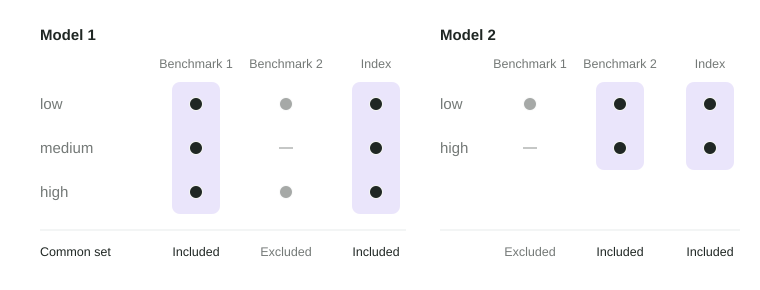

# Leaderboard Rules

These rules decide what the dashboard shows from the calculated scores: which models are listed, which scores appear, and how rows and charts present a model's reasoning efforts. They are applied after scoring and recalculate no score. One rule, [Preserved Rows](#preserved-rows), can show a model's scores from an earlier refresh.

## Dashboard Inclusion

The dashboard lists only models with enough observed evidence to compare. A score built on a handful of benchmarks can land almost anywhere, and estimates cannot stand in for observations. A variant is listed when it meets all of these requirements:

- An [identified model](../matching.md), a name, and confirmed text output.
- An observed benchmark count of at least seven, counted as described below.
- At least one observed frontier benchmark or aggregate index in each of Intelligence and Agentic. A benchmark or an index belongs to a capability when its [allocation](../benchmarks.md#reading-the-portfolio) there is above zero.
- At least two observed aggregate indexes, or one observed Artificial Analysis Intelligence Index or Epoch Capabilities Index.
- Finite :score[Intelligence] and :score[Agentic] scores above 10 each.

The eligible indexes are the Artificial Analysis Intelligence Index, CAIS Capabilities Index, Epoch Capabilities Index, Surge Intelligence Index, and Vals Index. No particular publisher, release age, or earlier listing is required, and a model that public catalogs do not list yet is included when its results qualify. Specifications such as the context window, release date, and token prices are not required either, and a missing one is shown as empty.

Inclusion counts observations matched to the exact variant, including observed zeros. It is separate from [score retention](intelligence-agentic.md#evidence-support-and-score-retention), which discounts thin evidence inside the score.

### Counting Observed Benchmarks

The count is the number of different benchmarks that a variant's observed results stand for. An observed frontier benchmark counts one, whatever its allocation. An observed aggregate index counts its [represented breadth](intelligence-agentic.md#represented-breadth-and-overlap), the number of benchmarks the index stands for. A baseline benchmark observed as a separate result adds nothing.

No benchmark counts twice. Where an index's components are known by name, each one counts once, even when it is also observed directly or is a component of a second observed index. A named component counts through its index whether it is a frontier benchmark, a baseline benchmark, or not in the portfolio at all. The rest of an index's breadth cannot be matched to named benchmarks, so it is added in full. That covers an index whose components are not mapped to benchmarks, and the Epoch Capabilities Index, which publishes no list of components and has a fixed breadth of 8.

The threshold is the smallest breadth among the indexes that publish how many benchmarks they contain, currently seven. One sufficiently broad index can therefore satisfy the count by itself.

### Hidden Model Groups

OpenAI Pro, Gemini Deep Think, and Claude Mythos models are never shown in the table, the frontier roles, or the charts, because of their specialized resourcing, operating policies, or assets. Ordinary Gemini Pro models and other high-reasoning variants are shown. Hiding a model changes neither its scores nor the reference population other models are scored against, and the API's page for a single model still returns it.

## Preserved Rows

A refresh can lose a source for a while, and a leading model's score would then fall for a reason that has nothing to do with the model. Each refresh therefore compares every listed variant's new row with its row in the previous refresh, and shows the previous row instead when three conditions hold: its previous :score[Intelligence] was at least 90, its new :score[Intelligence] is at least 10 points lower, and the previous row carries more values than the new one, counting its observed frontier benchmark and index results, its :score[Speed], and its three provider speed measurements (throughput, latency, and end-to-end latency). A variant that no longer qualifies for the list is not preserved.

The preserved row is shown unchanged, with all four scores and its benchmark results. Those scores were calculated against the earlier population, so they are not strictly relative to the models currently observed.

Preservation has no time limit: the preserved row becomes the previous row for the next refresh, so it stays until a refresh no longer meets the three conditions. A change to the scoring method also ends it.

## Ranks

Every row has a rank by :score[Intelligence], and rows with equal scores share a rank. With the table [Collapsed](#collapsed-and-expanded-rows), each base model is ranked once, at its shown variant. With the table Expanded, every reasoning effort is ranked as its own row. The API offers the same two rankings: its default lists rank base models, and its `efforts=all` option ranks every reasoning effort. The API's page for a single model lists all of that model's efforts without ranks.

## Resource Score Availability

A listed token price or serving speed does not show what it takes to complete useful work. :score[Speed] and :score[Value] are therefore shown only for a variant with observed quality paired with observed resources per task on at least four benchmarks. Time qualifies :score[Speed] and cost qualifies :score[Value], independently.

Each benchmark counts one when the variant has observed quality paired with a positive cost, or with directly reported seconds. The Artificial Analysis Intelligence Index counts its represented breadth when its observed result is paired with its own cost or runtime per task, less the components already counted as benchmarks for that resource. Its cost does not establish runtime coverage, and its measurements never fill in for a benchmark's own.

Estimated quality, estimated resources, runtime derived from output tokens, token prices, throughput, and latency do not count.

![In this illustration without index support, four direct cost pairs permit :score[Value]; three time pairs leave :score[Speed] unavailable. Estimates sit outside the four required slots and do not count toward either threshold.](../assets/methodology/resource-publication-gate.svg)

A variant that qualifies on quality stays in the table with an unavailable resource score left blank, and its prices and provider speed remain visible. Charts show a variant wherever its plotted values exist and never replace a missing score with zero. Every model's observations remain in the scoring reference population whether or not its scores are shown.

## Collapsed and Expanded Rows

The table's Effort picker switches every model between two modes. Collapsed shows one row per base model: the variant with the highest :score[Intelligence], with all of that variant's scores. Expanded shows a row for each selected reasoning effort.

A collapsed row's benchmark cells can show results from other efforts of the same model, in two cases. Where the shown variant has no result for a benchmark, the cell displays the result observed at the highest reasoning effort that has one. Where a benchmark's [sources are combined](sources.md#combining-sources), the cell shows the combination of each source's result at the highest effort that source reports for the model, wherever that combination exists. This is the only case where a cell overrides a result the shown variant has. Neither case changes the row's scores or whose scores are shown, but a filled-in result brings its cost, time, and tokens into the row's [relative task resources](#relative-task-resources).

## Frontier Roles

The dashboard's opening view names a few models by role. Each role is filled from the listed models:

| Role | Selection rule |
| --- | --- |
| Best Intelligence | Highest :score[Intelligence], taking each base model at its strongest variant. |
| Best Agentic | Highest :score[Agentic] across every listed reasoning effort. |
| Another Lab | Highest :score[Intelligence] from a lab other than those holding the two roles above. |
| Best Open Weight | Highest :score[Intelligence] among open-weight models. |
| Pareto Balance | Largest :score[Intelligence] × :score[Value] product on the Pareto frontier, which favors strength in both. Ties prefer higher :score[Intelligence]. |
| Pareto Value | Highest :score[Value] on the Pareto frontier among models strictly above the median :score[Intelligence]. Ties prefer higher :score[Intelligence]. |

The Pareto frontier holds the models that no other model matches or beats in both :score[Intelligence] and :score[Value] while beating it in one. The roles follow the dashboard's filters, except that the Pareto roles ignore the release-date and rank filters. The Pareto roles take each base model at its strongest variant and need that variant to have a :score[Value]. The median counts each such base model once, before any filter, and a model exactly at the median does not qualify for Pareto Value.

![Illustrative frontier: Pareto Balance touches the highest curve of equal :score[Intelligence] × :score[Value], and Pareto Value has the highest :score[Value] among frontier models above the median :score[Intelligence].](../assets/methodology/pareto-highlights.svg)

A model that wins several roles appears once, under all of its role names joined together. When no model qualifies for a role, a Pareto role is left out, and any other role is replaced by the highest model among the top five by :score[Intelligence] that holds no role yet, labelled with its place in the top five, such as Intelligence #3. Labels omit the reasoning effort, but the scores shown are those of the selected variant.

## Pareto Chart

The Pareto chart plots quality against resources. Quality is :score[Intelligence], :score[Agentic], or a selection of benchmarks. Resources are cost, time, or tokens as relative task resources, or the :score[Speed] or :score[Value] score. Each base model appears once, as its collapsed row, unless Variants is on, in which case every reasoning effort is its own point. The frontier line joins the points that no other point beats on both axes.

### Relative Task Resources

Relative cost, time, and tokens answer a descriptive question: how much does a model use compared with a typical model on the same benchmarks, whatever it achieved? Raw amounts cannot be compared across benchmarks because tasks differ in size, so each amount is divided by its benchmark's median, which makes 1× typical everywhere.

For amount $R_{m,b}$ of variant $m$ on benchmark $b$, the benchmark median $\tilde R_b$ is the [weighted median](operations.md#weighted-median-and-quantiles) of the positive observed amounts $R_{j,b}$ of every variant $j$ paired with observed quality, weighted by [reference weight](overview.md#reference-weight) $w^{\text{ref}}_{j,b}$. A variant's ratios across benchmarks are summarized by their weighted median $\rho_m$:

$$
\tilde R_b=\operatorname{weightedMedian}_j\left(R_{j,b};w^{\text{ref}}_{j,b}\right),\qquad \rho_{m,b}=\frac{R_{m,b}}{\tilde R_b},\qquad \rho_m=\operatorname{weightedMedian}_b(\rho_{m,b};w_b).
$$

Each benchmark has weight $w_b=1$. Where a benchmark's sources keep their resources [separate](sources.md#resources-across-sources), each source has its own ratio and the benchmark's weight of 1 is split equally among its sources, whether or not the variant has each one. An index has its [represented breadth](intelligence-agentic.md#represented-breadth-and-overlap) less the components already counted as benchmarks. A benchmark observed for fewer than two base models has no median. The medians come from the full model population, whichever models a chart shows.

Cost uses observed cost per task and time uses reported seconds. Tokens require an input and output count or a reported total; output tokens alone never stand in for the total. Derived runtime and estimates are not included.

These ratios ignore quality, so they feed neither :score[Speed] nor :score[Value]. A model's summarized ratio need not center on 1× even though every benchmark's median does, because models run different benchmarks.

### Common Evidence

Comparing a model's reasoning efforts is fair only on measurements all of them share: otherwise a difference in which benchmarks were measured would look like a difference caused by effort. Each model's variants are therefore compared on their common set of benchmarks, built separately for cost, time, and tokens.

The common set applies whenever the chart combines two or more benchmarks: when the quality axis is a selection of benchmarks, and when the resource axis is relative cost, time, or tokens. With :score[Intelligence] or :score[Agentic] on the quality axis, only the resource axis is built on the common set, and quality stays the published score. With Variants off, each model is a single point, so its set is simply the benchmarks that point has.

A benchmark enters a model's common set only when every variant of that model has both its quality and the resource observed. Quality on the set keeps its observed-range scaling and weighted mean, and resources are relative task resources over the same set. Each benchmark has weight 1, and a selected index has its represented breadth less one for each component included as a benchmark.

An aggregate index in the set, whether selected or included automatically, narrows the comparison: when at least one of a model's variants has such an index with both quality and the resource observed, only the variants that have one are compared, and the model's other variants are left out of the chart. The Common evidence details under the chart report how many were left out.

A single selected benchmark is plotted in its own units, except ALE-Bench, which is shown on the normalized 0–100 scale. Each model has its own common set, so the distance between two models is not a comparison on identical benchmarks. The chart never smooths results or forces quality to rise with effort.

## Parameter Choices

These values are display-policy choices, not fitted claims about model behavior.

| Parameter | Value | Why it exists |
| --- | ---: | --- |
| Inclusion benchmark count | 7, the smallest breadth among indexes with published baskets | Lets benchmark results or a broad index qualify a model without requiring a particular publisher. |
| Inclusion index requirement | Two indexes, or the Artificial Analysis Intelligence Index or Epoch Capabilities Index alone | Requires broad evidence beyond individual benchmarks. |
| Capability score floor | Above 10 for both :score[Intelligence] and :score[Agentic] | Leaves out models too weak to be relevant even when their resource scores are high. |
| Resource score availability | 4 benchmarks with observed quality and resource | Requires :score[Speed] and :score[Value] to rest on measured work. |
| Preserved row | Previous :score[Intelligence] at least 90, drop of at least 10, less evidence than before | Keeps a lost source from knocking down a leading model. |
| Pareto Value cutoff | Above the median :score[Intelligence] | Keeps the role for capable models. |
