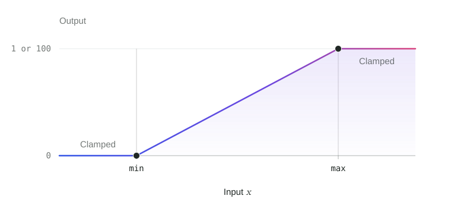
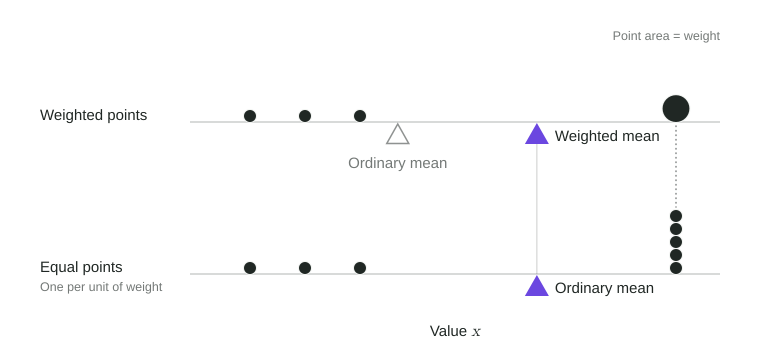
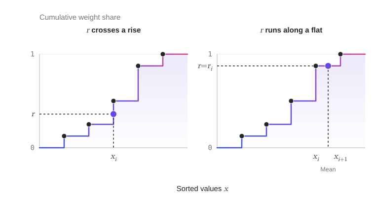
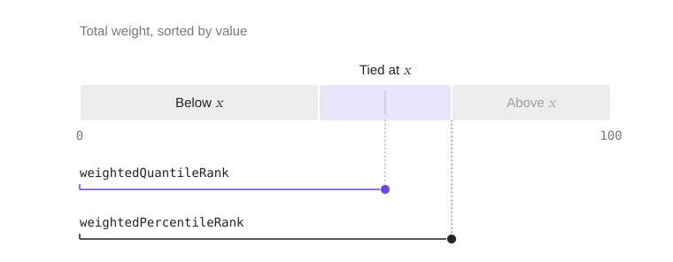
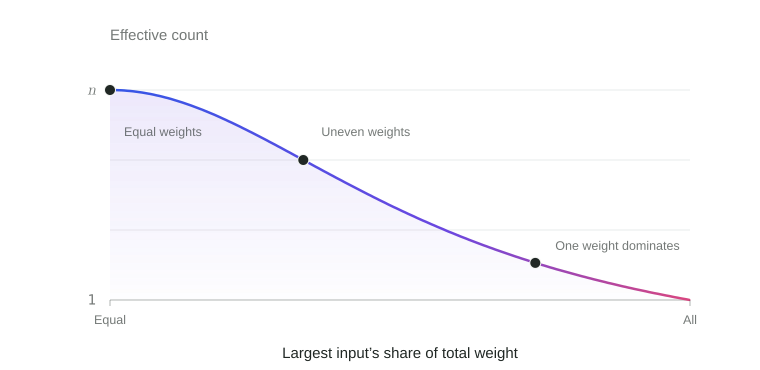
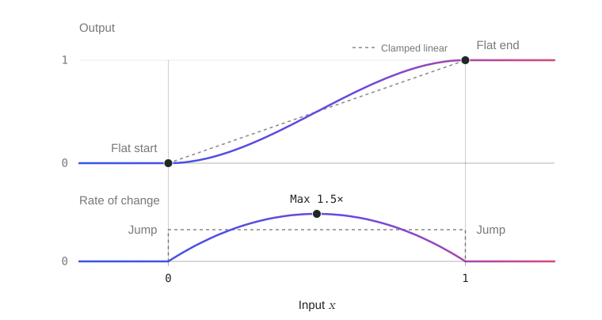

# Shared Operations

The scoring pages reuse a small set of operations. Each is defined once here, and every calculation that uses one states its own inputs, reference population, and weights.

## Linear Scaling and Clamping

Linear scaling places a value on a ruler from a chosen minimum to a chosen maximum: the minimum becomes 0, the maximum becomes 1, and halfway becomes 0.5. Clamping then holds values that fall outside the ruler at its nearest end. For lower bound $L$, upper bound $U>L$, and input $x$:

$$
\operatorname{linearScale}_{L}^{U}(x)=\frac{x-L}{U-L},\qquad
\operatorname{clamp}_{L}^{U}(x)=\min\bigl(U,\max(L,x)\bigr).
$$

The subscript is the lower bound and the superscript the upper bound. Scaling alone can return values below 0 or above 1; after clamping to 0–1, multiplying by 100 gives a 0–100 score. Each calculation states whether its bounds are observed values or chosen endpoints and whether it clamps. Missing inputs stay missing. When the bounds are equal, every value scales to 1, so a benchmark on which all models tie gives each of them 100.

## Weighted Mean

The weighted mean gives each value influence in proportion to its weight, so a benchmark or model counts as much as policy intends rather than as often as it appears in the data:

$$
\operatorname{weightedMean}_i(x_i;w_i)=\frac{\sum_i w_ix_i}{\sum_i w_i}.
$$

The subscript $i$ marks what the mean runs over, and the weight follows the semicolon; the operations below use the same convention. With equal weights, this is the ordinary mean.

Weighted means, medians, quantiles, and ranks use only finite values with positive finite weights. Missing values and zero, negative, or invalid weights are skipped; if nothing usable remains, these operations return missing rather than zero. Effective count has a separate empty-input rule below.

## Weighted Median and Quantiles

A weighted quantile at fraction $r$ is the value reached when the running total of weight first covers $r$ of the total weight. The weighted median is the quantile at $r=0.5$: half the weight lies at or below it. Medians resist extreme values, so they are used wherever one unusual model should not move a reference.

Equal values merge their weights. With the distinct values sorted as $x_1<\cdots<x_n$, the share $r_i$ of total weight held by the first $i$ values is:

$$
r_i=\frac{w_1+\cdots+w_i}{w_1+\cdots+w_n}.
$$

For $0<r<1$, the quantile is read at the first $i$ with $r_i\ge r$. If the running total lands exactly on $r$, the boundary falls between two values, and the quantile is their mean:

$$
\operatorname{weightedQuantile}(r)=
\begin{cases}
\dfrac{x_i+x_{i+1}}{2}, & r=r_i\text{ and }i<n,\\[6pt]
x_i, & \text{otherwise}.
\end{cases}
$$

At $r=0$ the quantile is the smallest value, and at $r=1$ the largest. The weighted median is $\operatorname{weightedMedian}_i(x_i;w_i)=\operatorname{weightedQuantile}(0.5)$. The ordinary median $\operatorname{median}_i(x_i)$ uses equal weights, so an even number of values gives the mean of the two middle values. Taking the mean at an exact boundary is the convention used here; other weighted-quantile definitions exist.

## Weighted Ranks

A weighted rank is the reverse of a quantile: it reports what share of the weight lies below a value $x$. The two rank operations differ only in how they count weight tied at $x$. The quantile rank counts half of it, placing tied values at the middle of their shared range:

$$
\operatorname{weightedQuantileRank}(x)=100\frac{\sum_{x_i<x}w_i+\tfrac12\sum_{x_i=x}w_i}{\sum_iw_i}.
$$

The percentile rank counts all of it:

$$
\operatorname{weightedPercentileRank}(x)=100\frac{\sum_{x_i\le x}w_i}{\sum_iw_i}.
$$

Both return 0–100; a calculation that needs a 0–1 fraction divides by 100. Rank-based imputation and the :score[Intelligence] calculations use the quantile rank, and resource efficiency scores use the percentile rank.

## Effective Count

Effective count measures how broadly influence is shared. Equal weights across $n$ inputs give $n$; as one weight dominates, the count falls toward 1. It is used where support should come from several inputs rather than one dominant one:

$$
\operatorname{effectiveCount}_i(w_i)=\frac{(\sum_iw_i)^2}{\sum_iw_i^2}.
$$

Scaling every weight by the same factor leaves the count unchanged. Invalid or nonpositive weights are excluded; with none remaining, the count is 0. Effective count describes the distribution of influence, not prediction accuracy or independence between inputs.

## Smoothstep

Smoothstep rises from 0 to 1 along an S-curve, easing in at the start and out at the end. It makes an adjustment change gradually near its thresholds, without the sharp corners of clamped linear scaling. Its input is clamped to 0–1, so the output stays at 0 below the interval and at 1 above it:

$$
\operatorname{smoothstep}(x)=u^2(3-2u),\qquad u=\operatorname{clamp}_{0}^{1}(x).
$$

It sets [score retention](intelligence-agentic.md#evidence-support-and-score-retention), [peer support](speed-value.md#peer-support), the [shared coverage multiplier](speed-value.md#shared-coverage-multiplier), and the Timeline's [evidence support](../timeline/overview.md#evidence-support), each with its own thresholds.

The coefficients are not tuned: $3u^2-2u^3$ is the simplest polynomial that starts at 0, ends at 1, and is flat at both ends, since its slope $6u(1-u)$ is zero at $u=0$ and $u=1$ and positive between them.
