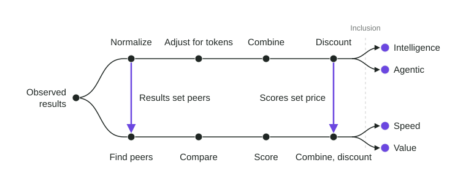
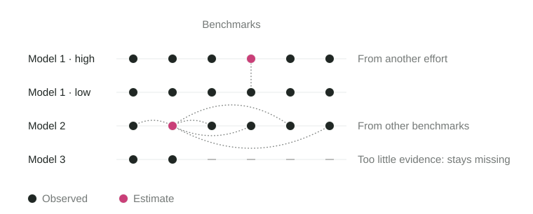
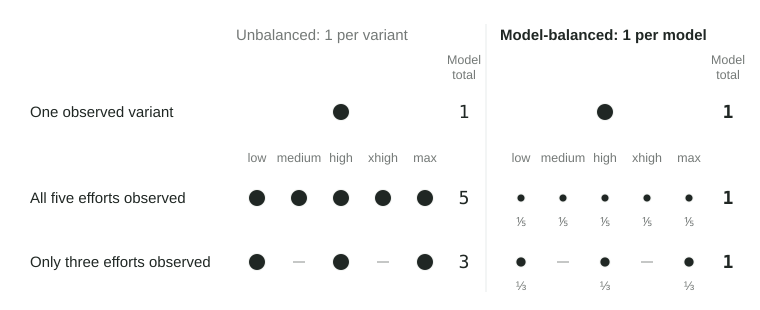

# Methodology

## What Model Atlas Measures

Model Atlas turns benchmark results, token use, prices, and runtimes into four separate 0–100 scores. :score[Intelligence] and :score[Agentic] describe capability; :score[Speed] and :score[Value] describe resource efficiency, responsiveness, and affordability.

| Score | What it measures |
| --- | --- |
| **:score[Intelligence]** | Solving difficult problems using knowledge, perception, understanding, abstract reasoning, and judgment. |
| **:score[Agentic]** | Reliably turning goals and specifications into working results through instruction following, planning, coding, tool use, verification, and recovery. |
| **:score[Speed]** | Completing work quickly at comparable quality, with fast token generation, low first-token latency, and short total response times. |
| **:score[Value]** | Delivering comparable-quality work at lower cost, combining cost per task with token prices assessed for affordability and efficiency at comparable capability. |

- **One benchmark can count toward both capabilities.** Its allocation splits its weight between Intelligence and Agentic according to what success on it requires. Implementing a specification is mainly Agentic, while deriving a difficult algorithm or scientific solution also counts toward Intelligence.
- **Efficiency accounts for quality.** :score[Speed] and :score[Value] compare resource use at similar quality, so a cheaper but much less capable model does not automatically score well on :score[Value].
- **Resources barely touch capability.** :score[Agentic] includes a bounded adjustment for token efficiency. Price and latency affect neither capability score.
- **Community judgment is bounded.** The [Trust Me Bro and Slop Indexes](intelligence-agentic.md#trust-me-bro-and-slop-indexes) move :score[Intelligence] by a limited amount where people's experience of overall practical work and of visual output contradicts the benchmark order.

## Key Terms

| Term | Meaning |
| --- | --- |
| Benchmark | An upstream evaluation with its own methodology and scoring rules. |
| Task | One unit of work within a benchmark. Resources per task are the cost, time, or tokens for that unit, in the source's reported task unit. |
| Aggregate index | One published score that combines several benchmarks, called its components. |
| Frontier and baseline benchmarks | Frontier benchmarks still separate current leading models, and only they carry weight in capability scores. Baseline benchmarks stay visible in the table and can help estimate a missing frontier result. |
| Source | One publisher's results for a benchmark. A benchmark can have several sources. |
| Base model and variant | A base model is one released model. A variant is that model at one reasoning effort, and every variant is scored separately. |
| Observed result and estimate | An observed result is one a source published for that exact variant. An estimate fills a gap from other observed results; the method is called imputation. |
| Quality and resources | Quality is how well a variant did on a benchmark, its result. Resources are what the run consumed: cost, time, and tokens. |

Reasoning-effort labels include `none`, `low`, `medium`, `high`, `xhigh`, and `max`. An unspecified effort is stored as `null`, which is distinct from an explicit `none`. Available settings depend on the model and source.

## How to Read the Scores

Scores are relative to the models currently observed, so they can change when a new model or result arrives. On each benchmark, the weakest observed result maps to 0 and the strongest to 100, so equal improvements within the observed range give equal score changes. A benchmark score of 100 means the strongest observed result, not perfect task completion. A final capability score is not an accuracy percentage, and twice the score does not mean twice the capability.

Each variant has its own four scores, and a model's scores are never averaged across its reasoning efforts into one.

The separate [Intelligence Index](../timeline/overview.md) keeps a saved scale for historical comparison and does not affect leaderboard scores or inclusion.

[Relative task resources](leaderboard-rules.md#relative-task-resources), shown in the table and the Pareto chart, are not scores. They compare the cost, runtime, and total tokens a model used with the median for the same benchmarks. Lower ratios mean less resource use, whatever quality was achieved. :score[Speed] and :score[Value] compare resources at similar quality and add provider speed or token prices, so their order can differ from these ratios.

## How the Scores Are Calculated

The four scores follow two paths from the same observed results, and each path ends by discounting thin evidence. On each benchmark, a model's time and cost are compared with those of models that scored similarly on it. Token prices are compared among models with similar final capability scores.

For :score[Intelligence] and :score[Agentic], each benchmark is [normalized](intelligence-agentic.md#normalization) so that its observed minimum maps to 0 and its maximum to 100. :score[Agentic] benchmark scores are then [adjusted for token efficiency](intelligence-agentic.md#agentic-token-efficiency) by up to ±15% and rescaled. [Benchmarks and indexes are combined](intelligence-agentic.md#combining-benchmarks-and-aggregate-indexes), with the benchmark part of :score[Intelligence] taking 20% from how models compare on the benchmarks they share. Thin evidence is [discounted](intelligence-agentic.md#evidence-support-and-score-retention): a score keeps 85–100%, more as more benchmark weight is backed by evidence.

For :score[Speed] and :score[Value], each benchmark's [similar-quality peers](speed-value.md#similar-quality-peers) are the other models that scored close to the variant on it. The variant's time and cost per task are compared with the [expected use](speed-value.md#expected-resource-use) at that quality and [scored](speed-value.md#resource-efficiency-score), with few similar-quality peers pulling the score toward 50. The inputs are then [combined](speed-value.md#combining-the-inputs) and thin evidence discounted; at full evidence, benchmark resources carry 70% and provider speed or token price 30%.

[Dashboard inclusion](leaderboard-rules.md#dashboard-inclusion) and [resource score availability](leaderboard-rules.md#resource-score-availability) then decide which models are listed and which scores are shown. Inclusion is decided after scoring, so leaving a model off the dashboard does not change the benchmark scales the others are scored on. :score[Speed] and :score[Value] are scored among the models that have both capability scores.

Benchmark, reasoning-effort, and resource coverage is uneven. Imputation fills supported gaps from relationships among observed results. **Estimates help calculate scores; they never count as direct evidence.** Only observed results set reference scales and satisfy the inclusion and resource score availability requirements. A validated [source crosswalk](sources.md#source-crosswalks) is not an estimate of this kind: it converts results between the sources of one benchmark so that they combine on a shared scale, and the combined result counts as an observed benchmark result. [Imputation](imputation.md#what-estimates-can-and-cannot-do) explains how each kind of estimate enters scoring and how its support is assessed.

## Reference Weight

Labs report different numbers of reasoning efforts, and a model with five reported variants would otherwise count five times wherever models are compared. Every base model therefore carries a total reference weight of 1, shared equally among its variants that have the observations a calculation needs. With $n$ such variants, each has weight $1/n$, and a variant without them has none. A calculation that uses these weights is called model-balanced.

Reference weights set how much each variant counts in a reference population: in medians and ranks, among similar-quality peers, in comparisons on shared benchmarks, in imputation, and in source crosswalks. They are never used to average a model's variants into one score.

## Where the Details Are

| Page | What it explains |
| --- | --- |
| [Intelligence and Agentic](intelligence-agentic.md) | Benchmark scores and weights, token efficiency, comparisons on shared benchmarks, aggregate indexes, and the discount for thin evidence. |
| [Speed and Value](speed-value.md) | Resource use at similar quality, provider speed, token prices, and how they combine. |
| [Imputation](imputation.md) | How gaps are estimated and what estimates may count toward. |
| [Sources](sources.md) | How results from several sources become one result per benchmark and variant, and how version changes, withdrawn results, and updated releases are handled. |
| [Leaderboard Rules](leaderboard-rules.md) | Which models are listed, which scores are shown, and what the table and Pareto chart present. |
| [Shared Operations](operations.md) | The scaling, weighted means, medians, ranks, and curves the other pages reuse. |

Policy parameters are listed with the calculations they control: [capability scores](intelligence-agentic.md#parameter-choices), [imputation](imputation.md#parameter-choices), [resource scores](speed-value.md#parameter-choices), [sources](sources.md#parameter-choices), and [leaderboard rules](leaderboard-rules.md#parameter-choices).
