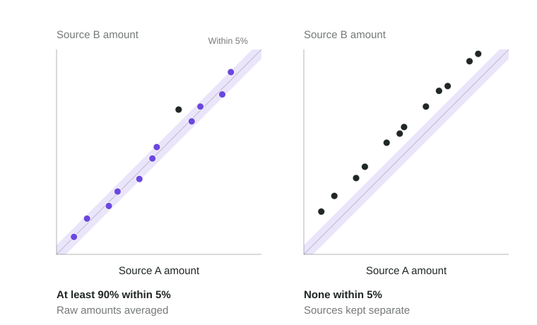

# Sources

A benchmark's results reach Model Atlas through one or more sources, and sources differ in which models they cover, which reasoning efforts they label, and how they account for cost and time. This page explains how their rows become one accepted result per benchmark and variant. [Benchmarks](../benchmarks.md#source-notes) lists the choices made for each benchmark.

## One Result per Benchmark and Variant

Results are combined only when they describe the same thing: compatible tasks and versions, metrics, scoring protocols, units, aggregation, model identities, and reasoning efforts. Measurements made by different methods stay separate unless a benchmark's policy defines how they combine.

A harness is the agent software a model is run inside. By default the harness label only describes how a result was produced: when a source later reports the same model and effort under a different harness label, the new result replaces the stored one. The exception is a source that publishes one model and effort under several harnesses at once, where each harness is a separate result. For coding benchmarks, rows from different harnesses stay distinct unless the benchmark defines how to aggregate them.

A model's result includes any fallback or routing its provider applies, such as answering refused questions with another model, because choosing that model delivers that behavior. A combination an evaluator assembles from several models is not any one model's result.

## The Source-Default Variant

Many sources report a model without naming a reasoning effort. Such an unlabelled observation belongs to the source-default variant: the model as the source ran it by default. The source-default variant is where a result reported for the model as a whole counts, including an [aggregate index result](intelligence-agentic.md#indexes-across-reasoning-efforts), and its evidence support sets the [shared coverage multiplier](speed-value.md#shared-coverage-multiplier) for all of the model's efforts.

When every observation of a model names an effort, the observation at the highest reported effort other than `none` also serves as the source default. A reasoning-off observation never does, because a reasoning model's default configuration thinks. That one observation is taken whole, with its score and its resource amounts, so the default never mixes values from different efforts. Each labelled row still belongs to its own variant, and every reported effort is stored.

Artificial Analysis can list a model both without an effort and at named efforts. Its unlabelled row is then not kept as a variant of its own: the source-default variant is the highest named effort other than `none`. Among a base model's variants, one matched to an Artificial Analysis listing is chosen as the source default before one that is not; among the rest, a variant without a named effort comes first, then the highest effort.

A hybrid model's labelled thinking or reasoning mode is its default configuration, not an effort, and its no-thinking mode is effort `none`.

## Combining Sources

Sources can report the same benchmark with different methodologies and model coverage. Where a benchmark declares its sources comparable, their quality scores combine at equal weight, without assuming any source is better: the combined result is the [mean](operations.md#weighted-mean) of the sources' scores. A mirror, a second source that republishes the same results, follows the same rule, so identical scores stay unchanged.

When a source publishes several configurations of one model and reasoning effort, Atlas stores them and scores none, unless the benchmark's own rule chooses among them, as Terminal-Bench's does by taking the strongest result. In a benchmark that combines sources, these configurations are left out before the sources combine, so the variant counts as missing from that source and can still receive a combined result through a [source crosswalk](#source-crosswalks).

For a variant that one source lacks, a crosswalk supplies the missing counterpart, so that every model sits on the same combined scale.

## Source Crosswalks

A crosswalk learns the typical score difference between two sources from the models both report, and uses it to place a result that only one source has onto the combined scale.

### Fitting the Offset

The offset is fitted on results paired by model and reasoning effort. For pair $i$, $A_i$ and $B_i$ are the two sources' results for the same variant, and $w^{\text{ref}}_i$ is its [reference weight](overview.md#reference-weight), so a model that reports more efforts has no extra influence. The offset $\delta$ is the typical difference $B-A$, positive when source B scores higher:

$$
\delta=\operatorname{weightedMedian}_i(B_i-A_i;w^{\text{ref}}_i).
$$

The [weighted median](operations.md#weighted-median-and-quantiles) limits the influence of outliers.

### Validation on Withheld Models

Validation asks whether the offset predicts a model it has not seen. For each paired result $i$, an offset $\delta^{\text{others}}_i$ is fitted on the other base models, leaving out every effort of its own, and used to predict the withheld source result.

The absolute prediction error is $|B_i-A_i-\delta^{\text{others}}_i|$. Only half of a two-source mean comes from the mapped counterpart, so the error in the combined result is half as large. The weighted median of those halved errors is the validation error $e$, in the benchmark's score units:

$$
e=\operatorname{weightedMedian}_i\left(\frac{\left|B_i-A_i-\delta^{\text{others}}_i\right|}{2};w^{\text{ref}}_i\right).
$$

### Acceptance

A crosswalk is accepted only if the paired observations and the usable validation predictions each cover at least six base models and $e$ stays within the benchmark's error limit. An accepted crosswalk uses $\delta$ fitted from all paired observations. A hat marks a mapped counterpart:

| Observed | Mapped counterpart | Combined result |
| --- | --- | --- |
| Both sources | None | $(A+B)/2$ |
| A only | $\hat B=A+\delta$ | $(A+\hat B)/2$ |
| B only | $\hat A=B-\delta$ | $(\hat A+B)/2$ |

The combined value is [clamped](operations.md#linear-scaling-and-clamping) to the benchmark's permitted score range. Raw source results stay stored separately.

Without an accepted crosswalk, a variant that only one source observed has no combined result, and that source's quality and resources for it are not scored. [Imputation](imputation.md) may still estimate the result, as for any missing benchmark; otherwise it stays missing. A benchmark can also declare that one source's results stand unchanged for as long as its other source has published no rows at all, when no offset can be fitted.

### Three Sources

Three sources of one benchmark combine at equal weight. Each pair of sources fits and accepts its own offset as above. A missing source is predicted from every observed counterpart whose pair crosswalk was accepted, as the mean of those predictions, and the combined result is the mean of the three values. Each combination of observed and missing sources is validated separately, on the results observed in all three sources. Each such result is withheld in turn. The offsets are refitted without any result of its base model, the sources that the combination treats as missing are hidden, and the three-source mean is predicted from the sources left visible. The error is the absolute difference between that prediction and the mean of the three observed results. The combination is accepted only when at least six base models yield predictions and their model-balanced median absolute error is within the limit.

### What an Accepted Crosswalk Counts As

An accepted crosswalk contributes one benchmark result with [evidence factor](intelligence-agentic.md#evidence-support-and-score-retention) 1. It takes part in normalization, comparisons on shared benchmarks, capability scoring, inclusion, and every later calculation that uses benchmark quality. It is not imputation: a result that only one source observed stays that source's observed result, moved onto the combined scale by an offset that has passed validation on withheld models. The stored record keeps which results were observed, which counterparts were mapped, the validation error, and whether a mapped value lies outside the range the paired models covered.

Offsets are fitted only from results both sources observed: a mapped counterpart is not a new source observation, and combined values are never fed back into fitting.

An accepted crosswalk for quality says nothing about cost, runtime, or tokens, which follow the separate rule below.

## Resources Across Sources

Averaging two sources' cost or time only makes sense when both measure the same thing. Sources can differ in retries, caching, task coverage, and what their clock includes, so resource amounts are combined only after they are shown to agree. A benchmark can combine quality while keeping some or all resources separate by source.

### Agreement Check

Cost, runtime, total tokens, and output tokens are checked separately, on amounts per task. The check pairs observed, positive amounts for the same model and reasoning effort. For pair $i$ with amounts $A_i$ and $B_i$, the absolute log ratio $|\ln(B_i/A_i)|$ measures disagreement the same way in both directions. The agreement share $a$ is the fraction of [reference weight](overview.md#reference-weight) whose larger amount is no more than 1.05 times its smaller amount:

$$
a=\frac{\sum_i w^{\text{ref}}_i\,\mathbf{1}\bigl[\,|\ln(B_i/A_i)|\le\ln 1.05\,\bigr]}{\sum_i w^{\text{ref}}_i}.
$$

The indicator $\mathbf{1}[\cdot]$ is 1 when the condition holds and 0 otherwise. Two sources' amounts are comparable when at least 10 base models are paired and $a\ge0.90$. Runtime additionally requires both sources to report the same kind of time measurement.

The check compares the original amounts without fitting an offset or rescaling either source, so a consistent gap fails and similar distribution shapes do not establish agreement.

### When the Amounts Agree

Two observed amounts combine as $(A+B)/2$.

When only one source reports a cost or token amount, that amount stands unchanged as the benchmark's amount and counts as observed, because the agreement check has shown that the two sources measure on one scale. A runtime is combined only when both sources report it with the same kind of time measurement. Otherwise the benchmark has no reported runtime for that variant, and its time is derived from output tokens as in [Resources per Task](speed-value.md#resources-per-task) or imputed.

### When the Amounts Do Not Agree

Each source's resources stay paired with that source's own quality observations and are scored against that source's own reference population. Amounts are neither averaged nor imputed from one source to another.

In :score[Speed] and :score[Value], each source then enters as its own input. With $n$ declared sources, each source's input carries $1/n$ of the benchmark's resource weight and its own evidence factor. A missing source has an evidence factor of zero; the sources that remain keep their shares and do not absorb it. The benchmark's full weight stays in the evidence-support denominator, and its sources still count as one benchmark for [resource score availability](leaderboard-rules.md#resource-score-availability). The [token-efficiency adjustment](intelligence-agentic.md#agentic-token-efficiency) follows the same split: each source supplies its share of the adjustment against its own quality and token references, and a missing or unsupported source stays neutral.

A benchmark with three sources always keeps resources separate by source.

## Version Changes and Withdrawn Results

A benchmark's version follows its source, which publishes the version in its data or fixes it by its address. A refresh that shares no version with the stored rows is a new version: its rows replace the benchmark's stored rows instead of merging with them, so two versions never share one scale. Within one version, revised results replace earlier ones row by row. A refresh that fetches only part of a source still shares its version and merges as usual.

Where a source publishes a version per run, only the runs in the newest major.minor version are kept. Its patch versions are pooled as one version, since they stay comparable. When the publisher scores its minor versions comparably and pools them on its own leaderboard, all runs in the newest major version are kept and pooled instead. A new version with a different structure, such as another component basket or subset layout, supplies no rows until Model Atlas's own definition of the benchmark is updated to read it. The same holds for a successor that the source publishes at a new address.

Tooltips, these pages, and the Timeline follow the version in the current snapshot. On the Timeline a new version starts a new benchmark identity, so its results are never read through the previous version's [conversion to the Intelligence Index scale](../timeline/calculation.md#connect-benchmark-generations).

A result that a working refresh no longer lists keeps scoring for 24 hours, so one incomplete page cannot erase it, and is then dropped. A failed refresh, or a source address that returned nothing while the source's other addresses worked, leaves its results in place.

## Updated Releases

A lab can replace a model with a dated update under the same name. Results published for the previous identity describe a different model, so each one needs fresh evidence before it counts for the replacement.

Artificial Analysis keeps listing such a model under its undated name. That name is read as the dated release only when the evidence agrees on a single dated release; [Dated Releases](../matching.md#dated-releases) gives the rule. The model then counts as an updated release for as long as that reading holds.

For the replacement, an observation of a frontier benchmark or aggregate index is kept only when at least one condition holds:

- Its value changed.
- Its source identifies the new release. Artificial Analysis and Vals are the two sources whose listings confirm the dated release, and an observation of theirs that names no model, or names the undated identity being replaced, counts as identifying it.
- Its observation date is newer than the previous result and no earlier than the release.
- An earlier refresh already accepted it for the replacement.

An observation from any other source that names no model, or the undated identity, needs one of the other conditions: a missing old value or a reputable source alone does not establish freshness. Baseline benchmark results are kept without this check.

For as long as the model counts as an updated release, a benchmark or index carries twice its [base weight](intelligence-agentic.md#weights-and-the-benchmark-mean) in the replacement's :score[Intelligence] and :score[Agentic] when Artificial Analysis and Vals are its only sources, or when the replacement's result for it came from one of them. The doubling leaves [comparisons on shared benchmarks](intelligence-agentic.md#shared-benchmark-comparisons-for-intelligence) at their base weights. The replacement's benchmark results are not imputed, although its cost and time can be.

## Parameter Choices

These values are scoring-policy choices, not fitted claims about model behavior.

| Parameter | Value | Why it exists |
| --- | ---: | --- |
| Source crosswalk models | 6 | Requires paired and held-out evidence from several base models before mapping a missing source. |
| Source crosswalk error limit | Set per benchmark in its own score units | Keeps mapped counterparts close to observed results; [Benchmarks](../benchmarks.md#source-notes) lists each limit. |
| Resource agreement | 10 paired base models; 90% of reference weight within a factor of 1.05 | Allows amounts from different sources to be averaged only when nearly all paired models agree. |
| Withdrawn result grace period | 24 hours | Keeps one incomplete source page from erasing results. |
| Updated-release source weight | 2× for kept Artificial Analysis and Vals observations | Gives the two sources that confirm the update more influence on an updated release's capability scores. |
