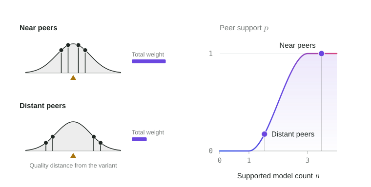
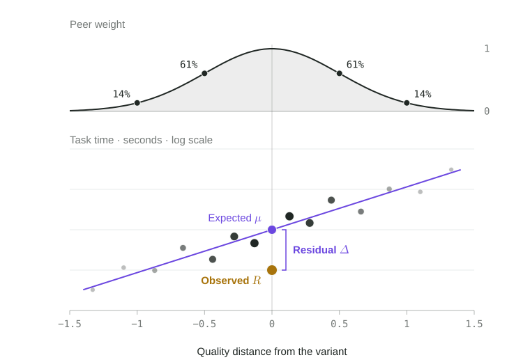
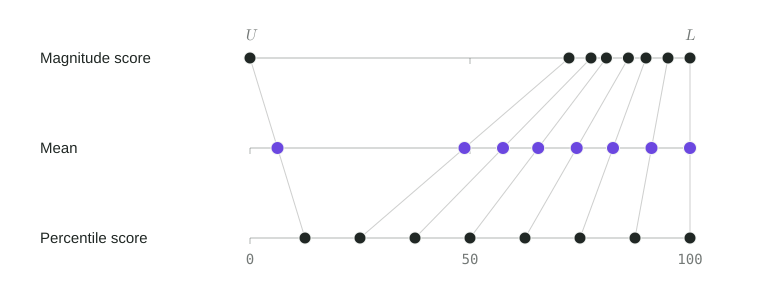
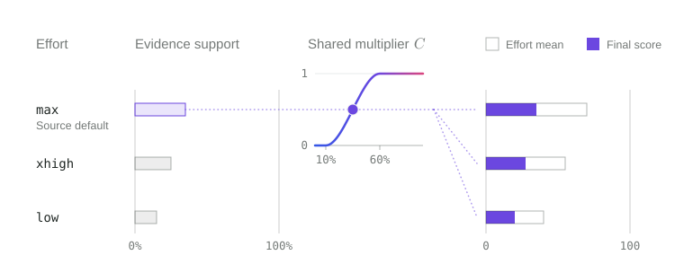

# :score[Speed] and :score[Value]

:score[Speed] and :score[Value] describe what a model's work costs in time and money. Most of each score comes from resources measured on benchmarks, compared among models of similar quality; the rest comes from provider speed for :score[Speed] and token prices for :score[Value]. Which variants show these scores is decided separately, under [resource score availability](leaderboard-rules.md#resource-score-availability).

## Inputs and Shares

Each score is a weighted mean of inputs. Benchmark resources hold 70% of the base weight and other measurements 30%:

| Score | Benchmark resources: 70% | Other measurements: 30% |
| --- | --- | --- |
| :score[Speed] | Time per task at similar quality | Throughput, first-token latency, and end-to-end latency: 10% each |
| :score[Value] | Cost per task at similar quality | Absolute and quality-adjusted token price: 15% each |

The benchmarks with resource evidence share the 70% equally. These proportions hold when every input has full evidence. An input a variant lacks drops out of its weighted mean, and an estimated input counts for less. Both lower the variant's [evidence support](#evidence-factors), the share of the score's base weight that its evidence covers.

## Resources per Task

A benchmark resource is an amount per task: $R_{m,b}$ is the time in seconds or the cost per task of variant $m$ on benchmark $b$.

Amounts come from the same benchmark and reasoning effort as the quality they are compared at. A source's totals are divided by the number of task executions they cover, with repeated runs counted as separate executions, so amounts from sources with different run counts stay comparable.

When a benchmark reports no time per task, it is derived as the time to write its output tokens at the provider's served [throughput](#provider-speed), without the waits before first tokens; total tokens cannot stand in for output tokens. A derived time is scored like a reported one, although it does not count toward resource score availability. Other gaps can be filled by [resource imputation](imputation.md#resources-across-reasoning-efforts). A source-wide average never replaces a benchmark's own measurement, and an aggregate index's cost and runtime do not enter these scores.

A cost per task reflects the token prices in force when the benchmark ran. A model's price change is recorded with its effective date and its input and output prices before and after, and only a change that moves both prices by one ratio is accepted, because a cost per task does not record how it divides between input and output. A benchmark result first recorded on or before that date, and unchanged since in quality, cost, time, and tokens, has its cost multiplied by the ratio, so the model's task costs and its token price describe the same prices. A result that has changed since is taken as reported.

Sources of one benchmark can account for cost and time differently. [Resources Across Sources](sources.md#resources-across-sources) explains when their amounts are averaged and when each source is scored as its own input.

## Resource Use at Similar Quality

Lower resource use alone does not establish efficiency: a model may spend less because it achieves less. Each benchmark resource is therefore compared with what models of similar quality on that benchmark use. The comparison has four steps: weigh the other models by how close their quality is, measure how much support that gives, predict the resource use expected at the variant's quality, and score the difference.

The first three steps also serve [:score[Agentic] token efficiency](intelligence-agentic.md#agentic-token-efficiency), which compares tokens per task in the same way. An amount in those steps can therefore be a token count as well as a time or a cost.

### Similar-Quality Peers

Peers are the other base models with both quality and the resource observed on the benchmark, weighted by how close their quality is to the variant's. Quality starts from the benchmark's reported result $x_{m,b}$ in its own units, not its 0–100 benchmark score. The choice of units does not matter, because quality differences are divided by a spread measured in the same units.

The result is centered on the [weighted median](operations.md#weighted-median-and-quantiles) and divided by a robust spread, which gives the standardized quality $q_{m,b}$ and makes quality distances comparable across benchmarks. The center and spread come from every variant $j$ with both quality and the resource observed on the benchmark, the variant's own base model included. Each has [reference weight](overview.md#reference-weight) $w^{\text{ref}}_{j,b}$, $Q(0.25)$ and $Q(0.75)$ are the [weighted quantiles](operations.md#weighted-median-and-quantiles) of their results at fractions 0.25 and 0.75, and $x_{\min,b}$ and $x_{\max,b}$ are the smallest and largest of those results:

$$
\begin{aligned}
s^{q}_b&=\max\left(\frac{Q(0.75)-Q(0.25)}{1.349},\ 0.35\,(x_{\max,b}-x_{\min,b})\right)\\
q_{m,b}&=\frac{x_{m,b}-\operatorname{weightedMedian}_j(x_{j,b};w^{\text{ref}}_{j,b})}{s^{q}_b}
\end{aligned}
$$

The interquartile range covers the middle half of the observations, and 1.349 converts it to a standard-deviation-like scale. The floor of 35% of the observed quality range keeps small differences among tightly clustered results from looking large. Only observed results paired with the resource set the range. When every reference result has the same quality, only variants with exactly that quality have peers.

Gaussian weights favor peers near the variant's quality, with width 0.5. The indicator $\mathbf{1}[\cdot]$ removes every effort of the variant's own base model, so a model is never compared with itself:

$$
w^{\text{peer}}_{m,j,b}=\mathbf{1}[g(m)\ne g(j)]\,w^{\text{ref}}_{j,b}\exp\left(-\frac{1}{2}\left(\frac{q_{m,b}-q_{j,b}}{0.5}\right)^2\right)
$$

Here $g(m)$ is the base model of variant $m$. A peer at identical quality keeps its full reference weight, one at a standardized quality difference of 0.5 about 61% of it, and one at a difference of 1 about 14%.

### Peer Support

Peer support decides how far a comparison may move a score. Several base models of similar quality allow a strong adjustment; a few distant ones do not. It is calculated for each benchmark and resource, and counts base models, not variants.

The supported model count $n^{\text{sup}}_{m,b}$ is the total peer weight:

$$
n^{\text{sup}}_{m,b}=\sum_j w^{\text{peer}}_{m,j,b}.
$$

Each base model's variants share a reference weight of at most 1, so the count never exceeds the number of peer models, and distant peers add little to it. The count can be fractional, and is zero without positive peer weight.

Peer support $p$ rises from 0 at a supported model count of 1 to 1 at a count of 3: the count is [scaled linearly](operations.md#linear-scaling-and-clamping) between the two and passed through the [smoothstep curve](operations.md#smoothstep):

$$
p_{m,b}=\operatorname{smoothstep}\bigl(\operatorname{linearScale}_{1}^{3}(n^{\text{sup}}_{m,b})\bigr).
$$

Peer support acts in three places: the [expected amount](#expected-resource-use), the [resource efficiency score](#resource-efficiency-score), and the [token adjustment](intelligence-agentic.md#agentic-token-efficiency):

| Supported model count | $p$ | Expected amount | Resource efficiency score | Token adjustment |
|---|---|---|---|---|
| 1 or less | 0 | The peers' mean, with no quality trend | 50 | None |
| 2 | 0.5 | Halfway from the peers' mean to the trend, in log amounts | Halfway from 50 to the calculated score | Half |
| 3 or more | 1 | The trend | The calculated score | Full |

Peer support is separate from the [evidence support](#evidence-factors) displayed with a score.

### Expected Resource Use

Expected resource use is the amount that peers suggest for the variant's quality. Amounts are compared as natural logarithms, so proportional differences count equally at every scale.

With $y_{j,b}=\ln R_{j,b}$ the log amount of peer $j$, the peer weights give a local [weighted mean](operations.md#weighted-mean) $\bar y_{m,b}$. A line predicting log amount from quality is fitted with the same weights. Its intercept $\hat\alpha$ is the prediction at the variant's quality, and its slope $\hat\beta$ the change in log amount per unit of standardized quality:

$$
\begin{aligned}
\bar y_{m,b}&=\frac{\sum_j w^{\text{peer}}_{m,j,b}\,y_{j,b}}{\sum_j w^{\text{peer}}_{m,j,b}}\\
(\hat\alpha,\hat\beta)&=\arg\min_{\alpha,\beta}\sum_jw^{\text{peer}}_{m,j,b}\left[y_{j,b}-\alpha-\beta(q_{j,b}-q_{m,b})\right]^2.
\end{aligned}
$$

The line is not allowed to extrapolate. It is evaluated at $q'_{m,b}$, the variant's quality clamped to the peers' quality range, and its prediction $y'_{m,b}$ is clamped to the peers' range of log amounts. Peer support then blends the local mean with this bounded trend, and exponentiating returns the expected amount $\mu_{m,b}$ in dollars, seconds, or tokens:

$$
\begin{aligned}
q'_{m,b}&=\operatorname{clamp}_{\min_jq_{j,b}}^{\max_jq_{j,b}}(q_{m,b})\\
y'_{m,b}&=\operatorname{clamp}_{\min_jy_{j,b}}^{\max_jy_{j,b}}\left(\hat\alpha+\hat\beta(q'_{m,b}-q_{m,b})\right)\\
\mu_{m,b}&=\exp\left(\bar y_{m,b}+p_{m,b}(y'_{m,b}-\bar y_{m,b})\right)
\end{aligned}
$$

When every peer has the same quality, no slope can be fitted. The trend is then left out, $y'_{m,b}=\bar y_{m,b}$, and the expected amount is the local mean whatever the peer support.

The residual $\Delta_{m,b}$ is the log ratio of the observed amount to the expected one:

$$
\Delta_{m,b}=\ln\left(\frac{R_{m,b}}{\mu_{m,b}}\right).
$$

A negative residual means less resource use than expected at that quality, and a positive residual more.

### Resource Efficiency Score

The residual becomes a 0–100 score as the mean of two readings: how large the advantage is, and where it ranks. Size keeps a large advantage worth more than a small one; rank keeps one extreme result from pressing everyone else into a narrow band.

Both readings place the residual among the supported residuals: those of variants whose quality and amount on the benchmark are not estimates and whose peer support is above zero. They are model-balanced: each base model's variants share a total [reference weight](overview.md#reference-weight) of 1.

The magnitude score measures the size of the advantage. Its lower limit $L_b$ is the 2.5th percentile of the supported residuals and its upper limit $U_b$ their maximum, so an exceptionally low resource use cannot stretch the scale:

$$
S^{\text{mag}}_{m,b}=100\left[1-\operatorname{linearScale}_{L_b}^{U_b}\bigl(\operatorname{clamp}_{L_b}^{U_b}(\Delta_{m,b})\bigr)\right].
$$

The percentile score $S^{\text{pct}}_{m,b}$ is the [weightedPercentileRank](operations.md#weighted-ranks) of the negative residual among the supported residuals, so lower resource use ranks higher. The two readings are averaged:

$$
\bar S_{m,b}=\frac{S^{\text{mag}}_{m,b}+S^{\text{pct}}_{m,b}}{2}.
$$

Peer support then pulls the result toward 50, so a comparison against few similar-quality models cannot produce an extreme score:

$$
S^{\text{res}}_{m,b}=50+p_{m,b}(\bar S_{m,b}-50).
$$

If the supported residuals have no meaningful spread, every scored residual receives 50. A residual from an estimated quality or amount is scored against the supported residuals but never joins them, so it changes neither the limits nor the ranks.

## Input Scaling

Provider speed and absolute price are single measurements, not comparisons, and are scaled directly to 0–100 on a log scale so that equal ratios count equally. For measurement $x$ with lower bound $L$ and upper bound $U$, the score when higher is better is:

$$
S_{\uparrow}(x)=100\operatorname{clamp}_{0}^{1}\bigl(\operatorname{linearScale}_{\ln L}^{\ln U}(\ln x)\bigr)
$$

The score when lower is better reverses the same scale:

$$
S_{\downarrow}(x)=100\operatorname{clamp}_{0}^{1}\bigl(1-\operatorname{linearScale}_{\ln L}^{\ln U}(\ln x)\bigr)
$$

The reference values are the measurements of every variant that has both capability scores, whether or not the dashboard lists it. For provider speed, $L$ and $U$ are the smallest and largest of them, so no value is clamped. For price, $U$ is the highest price, while $L$ is the model-balanced 2.5th [percentile](operations.md#weighted-median-and-quantiles) and not the lowest price. Every price below it receives 100, so one exceptionally cheap model cannot stretch the scale.

If every reference value is equal, each receives 100, as in [benchmark normalization](intelligence-agentic.md#benchmark-scores).

## Provider Speed

Provider speed is how fast a model is served, apart from how much work a task takes. Its three measurements are throughput, first-token latency, and end-to-end latency. Throughput is how many output tokens, reasoning included, a model writes per second once its first token arrives, so the wait before that token counts only in the two latencies. Each is [scaled](#input-scaling) between the smallest and largest reference value of its own measurement, throughput with $S_{\uparrow}$ and the two latencies with $S_{\downarrow}$.

The measurements come from OpenRouter, which reports them for a model and not for a reasoning effort, so every effort of a model shares them. [Model Matching](../matching.md#openrouter-routes) explains which OpenRouter listing supplies a model's measurements.

OpenRouter serves a model through endpoints, each one provider's hosting of it. Each endpoint's recent history is averaged. The endpoints of the default service tier are then combined in a [weighted mean](operations.md#weighted-mean) with the tokens each served as weights, so a fast host that serves little traffic counts little. An endpoint without recorded volume is left out.

OpenRouter reports whole-request throughput instead: a request's output tokens divided by the whole request time, the wait before the first token included. It understates how fast a model writes, most of all for short replies after a long wait, so each endpoint's whole-request throughput is converted to throughput before the weighted mean. With $v$ its mean whole-request throughput, $t^{\text{first}}$ its mean first-token latency, and $t^{\text{e2e}}$ its mean end-to-end latency, $v\,t^{\text{e2e}}$ estimates the tokens a request writes and $t^{\text{e2e}}-t^{\text{first}}$ the time spent writing them:

$$
v'=\frac{v\,t^{\text{e2e}}}{t^{\text{e2e}}-t^{\text{first}}}
$$

An endpoint whose history lacks either latency, or whose end-to-end latency does not exceed its first-token latency, gives no throughput.

The conversion assumes that a model starts writing when its first token arrives. A model whose API streams only a summary of its reasoning, such as OpenAI's GPT models, likely writes part of that reasoning before its first token, so its first-token latency includes writing time and the conversion overstates its throughput. Artificial Analysis's output speed is a whole-request throughput that keeps such reasoning in both its token count and its time. Against it, the throughput of such models runs about a quarter high and their whole-request throughput about 30% low, while other models' throughput typically lies within a tenth of it. Atlas accepts this as a known tradeoff: the conversion brings most models' throughput close to that measurement and still misses these models by less than their whole-request throughput does, although within :score[Speed] it ranks them slightly high on throughput.

When no endpoint has both history and volume, first-token latency falls back to the lowest endpoint median, as OpenRouter's own model page summarizes it. Throughput has no such fallback, because the page shows only whole-request throughput and no end-to-end latency to convert it with. Where OpenRouter still lacks a measurement, Artificial Analysis's measurement of the same variant fills it, so a model's efforts can differ on a filled measurement. Artificial Analysis's output speed fills throughput unchanged: its benchmark requests are likely long enough that the wait is a small share of each, so it tracks throughput rather than OpenRouter's whole-request throughput.

## Token Price

Token price enters :score[Value] as two readings of one blended price: how cheap it is outright, and how cheap it is for the capability it buys.

### Blended Token Price

Blended price is the cost of a million tokens of agent work, in USD. An agent resends its whole conversation with every request, so most of the input it pays for is cache reads of context already sent, and a price that ignores caching misstates what agent work costs. The blend prices one fixed workload, not each model's observed traffic, so models with the same listed prices always share a blended price.

A workload whose tokens are a share $r^{\text{new}}$ of new input and $r^{\text{out}}$ of output, with every other token a cache read, costs $P(r^{\text{new}},r^{\text{out}})$ at cache-read price $P^{\text{read}}$, new-input price $P^{\text{new}}$, and output price $P^{\text{out}}$. Agent workloads range from long sessions, with 2.5% new input and 0.3% output, to short tasks, with 5% and 1.5%, and the blended price $P^{\text{blend}}$ is the midpoint of that range:

$$
\begin{aligned}
P(r^{\text{new}},r^{\text{out}})&=\left(1-r^{\text{new}}-r^{\text{out}}\right)P^{\text{read}}+r^{\text{new}}P^{\text{new}}+r^{\text{out}}P^{\text{out}}\\
P^{\text{blend}}&=\tfrac{1}{2}\left[P(2.5\%,0.3\%)+P(5\%,1.5\%)\right]=0.9535\,P^{\text{read}}+0.0375\,P^{\text{new}}+0.009\,P^{\text{out}}
\end{aligned}
$$

The shares are a policy choice informed by observed agent token use: long coding sessions re-read nearly all of their context, while shorter evaluation tasks send proportionally more new input and output. Because cost is linear in the shares, the midpoint of the range is the cost of the midpoint workload. :score[Value] scores the blended price alone; the two ends show how strongly a model's price depends on the workload.

Every price is a listed rate. New input pays the cache-write price where one is listed, because providers that charge for cache writes bill each new token as one; otherwise it pays the input price. A missing cache-read price counts as a tenth of the input price, the median listed ratio.

Each OpenRouter [endpoint](#provider-speed) of the default service tier is priced at its own listed rates, with a missing cache price resolved from that endpoint's input price. The endpoints combine in a [weighted median](operations.md#weighted-median-and-quantiles) with their reported token volumes as weights, which gives the price most of the model's tokens pay, so an endpoint charging a little more for a sliver of the traffic leaves it unchanged. Every effort of a model shares the result. Without an endpoint that served tokens, listed catalog prices apply, with Artificial Analysis prices filling missing fields as described in [Model Matching](../matching.md#resource-fields).

The input, cache-read, and output prices shown beside the blend are the same token-weighted listed rates. OpenRouter's effective prices, what its traffic paid after cache discounts, are not used, because those discounts reflect how each model's users cache, not its pricing.

### Absolute and Quality-Adjusted Price

Absolute price is $S_{\downarrow}(P^{\text{blend}})$, with the price limits of [Input Scaling](#input-scaling). A free model is treated as costing 0.001 USD per million tokens, below every listed price, so its logarithm stays finite.

Quality-adjusted price asks whether a model is cheap for what it can do. It applies the [similar-quality comparison](#resource-use-at-similar-quality) above to $\ln P^{\text{blend}}$, with the mean of the variant's final :score[Intelligence] and :score[Agentic] scores as the quality, before the [community correction](intelligence-agentic.md#trust-me-bro-and-slop-indexes) to :score[Intelligence].

## Combining the Inputs

For score $d$, either :score[Speed] or :score[Value], each input $i$ has a base weight $w^{\text{base}}_i$ from the [shares above](#inputs-and-shares) and a 0–100 score $S_{m,i}$: a resource efficiency score for a benchmark, or a scaled measurement for provider speed and price.

### Evidence Factors

The evidence factor $f_{m,i}$ is the fraction of an input's base weight that a variant's evidence supports, giving the weight $w_{m,i}=w^{\text{base}}_if_{m,i}$. An observed input has a factor of 1. An input whose quality is an estimate carries that estimate's evidence factor, and an estimated resource multiplies it by its own factor $f^{\text{res}}$, both described in [Imputation](imputation.md#what-estimates-can-and-cannot-do).

The score before coverage is the weighted mean of the inputs, and evidence support $c_{m,d}$ is the share of the total base weight that the variant's weights cover:

$$
\frac{\sum_iw_{m,i}S_{m,i}}{\sum_iw_{m,i}},\qquad c_{m,d}=\frac{\sum_iw_{m,i}}{\sum_iw^{\text{base}}_i}.
$$

### Shared Coverage Multiplier

The shared coverage multiplier reduces a score backed by little resource evidence. All variants of a base model share one multiplier, taken from the evidence support of its [source-default variant](sources.md#the-source-default-variant), so efforts measured on different numbers of benchmarks do not receive different discounts for that reason alone. A source-default variant that lacks an :score[Intelligence] or an :score[Agentic] score hands this role to the model's highest-effort variant that has both. For base model $g$ with source-default evidence support $c_{g,d}$:

$$
C_{g,d}=\operatorname{smoothstep}\bigl(\operatorname{linearScale}_{0.1}^{0.6}(c_{g,d})\bigr).
$$

The multiplier is zero through 10% evidence support and reaches one at 60%. The final score multiplies each variant's own weighted mean by its base model's multiplier:

$$
S_{m,d}=C_{g(m),d}\,\frac{\sum_iw_{m,i}S_{m,i}}{\sum_iw_{m,i}}.
$$

The two discounts act at different levels: peer support on each resource comparison, the shared coverage multiplier on the whole :score[Speed] or :score[Value] score.

## Parameter Choices

These values are scoring-policy choices, not fitted claims about model behavior.

| Parameter | Value | Why it exists |
| --- | ---: | --- |
| Benchmark resources versus other measurements | 70% / 30% of base weight | Keeps resources measured per task as the main evidence while retaining provider speed and token prices. |
| Provider speed measurements | 10% each for throughput, first-token latency, and end-to-end latency | Treats generation rate, response start, and response completion as equal parts of provider speed. |
| Price readings | 15% each for absolute and quality-adjusted price | Retains both affordability and price efficiency at comparable capability. |
| Blended price workload | Midpoint of 2.5% new input with 0.3% output and 5% new input with 1.5% output | Prices agent work, where most input is re-read context, at one workload shared by every model. |
| Missing cache-read price | A tenth of the input price | The median ratio among listed prices. |
| Free-model price | 0.001 USD per million tokens | Keeps a free model's logarithm finite while ranking it below every listed price. |
| Quality comparison width | 0.5 | Favors comparisons at similar quality without requiring exact ties in benchmark score. |
| Minimum quality spread | 35% of the observed quality range | Keeps small gaps in clustered results from being magnified. |
| Peer support | None at a supported model count of 1; full at 3 | Pulls weak comparisons toward neutral; a supported model count of three ends the pull without implying statistical certainty. |
| Local resource trend | Blended in by peer support; never extrapolated | Accounts for nearby quality differences while avoiding sparse fits and unsupported extrapolation. |
| Favorable-tail limit | 2.5th percentile | Stops one exceptionally low price or resource residual from defining the useful score range. Provider speed has no such limit. |
| Shared coverage multiplier | 0 through 10% evidence support; smooth rise to 1 at 60% | Withholds most of the score from base models with little resource evidence without requiring every input. |
