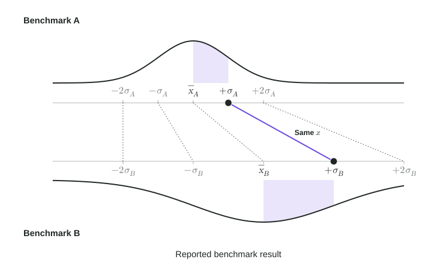
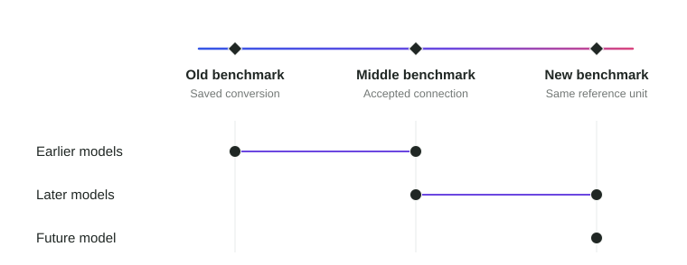
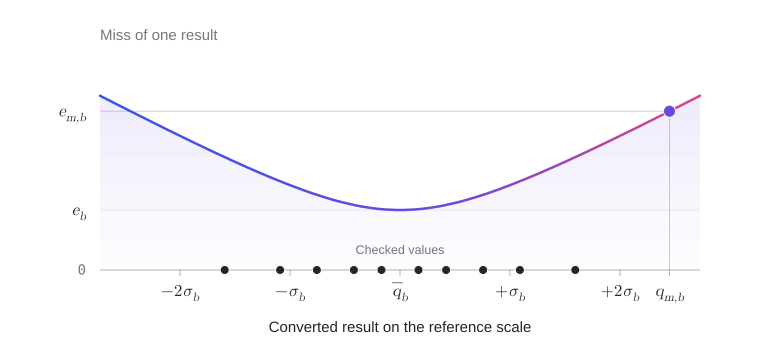

# Timeline Calculation

The Intelligence Index converts benchmark results to a saved reference scale, combines each variant's converted results into one position, and expresses that position in fixed index units. The [Timeline overview](overview.md) covers the chart and the method's limits.

## Freeze the Initial Reference

Leaderboard scores are relative to the models observed at each refresh, so they move as models and benchmarks change and cannot serve as a scale across years. The reference scale is therefore taken once, from a saved snapshot of :score[Intelligence] scores, and later leaderboard scores never replace it. Each snapshot score was saved with the leaderboard's [evidence support](../methodology/intelligence-agentic.md#evidence-support), the share of the leaderboard's benchmark portfolio that evidence backed for that variant. Only snapshot scores with at least 60% of it define the reference, and their models are the reference models; less-supported scores stay on record and fit nothing. The [Timeline's evidence support](overview.md#evidence-support) that the chart reads out is a different quantity.

The snapshot scores enter the calculation as one more benchmark. A model's result on it is its snapshot score, which is already in reference-scale points, so its conversion to the reference scale changes nothing. Every chain of [connections](#connect-benchmark-generations) starts here: a benchmark observed on enough snapshot models connects to the snapshot scores directly, by the same fit and validation as any other pair of benchmarks.

The snapshot scores only fix the scale that benchmark conversions are fitted against; they never count as a result in a position. A reference model's position comes from its own observed results, like any other model's, and its snapshot score stands in only while those results cannot place it.

## Connect Benchmark Generations

Two benchmarks observed on the same models can be converted into each other even when their units and difficulty differ, and a chain of such connections carries a benchmark of any generation to the reference scale.

Every result stays in its reported units. No transform stretches one part of a benchmark's range relative to another, so equal improvements cover equal distance anywhere in the range. A connection treats equal standard scores as equal results: the result a given number of standard deviations above benchmark A's mean corresponds to the result the same number of standard deviations above benchmark B's mean.

$$
\frac{x_A-\bar x_A}{\sigma_A}=\frac{x_B-\bar x_B}{\sigma_B}.
$$

Here $x_A$ and $x_B$ are results on the two benchmarks, and $\bar x_A,\bar x_B$ and $\sigma_A,\sigma_B$ are the means and standard deviations of the results from variants observed on both. Both are model-balanced: each base model carries a total [reference weight](../methodology/overview.md#reference-weight) of 1 across its variants, so reporting more reasoning efforts gives a model no more influence. Because each benchmark is standardized by its own mean and spread, rescaling its units leaves the connection unchanged. A converted value is a corresponding position on the other benchmark's scale, not an observed result.

A percentage result outside 0% to 100% is not used at all. Percentage results at or below 2% or at or above 98% are left out of the fit, so results pinned near a floor or ceiling do not shape a connection; they still place their models.

### Validate the Connection

Matching means and standard deviations always yields a line, whether or not models fall near it, so each connection is checked on base models it was not fitted on. One base model is left out with all its variants, so another reasoning effort of the same model cannot give the answer away. The connection is fitted on the rest, the training results, and each left-out result is predicted from that variant's result on the other benchmark. The check repeats for every base model and in both directions.

Each absolute prediction error is divided by the range of the training results on the predicted benchmark and multiplied by 100, which makes errors comparable across units. The errors in each direction are summarized by a model-balanced [weighted median](../methodology/operations.md#weighted-median-and-quantiles).

A connection is accepted when all of these hold:

- At least four base models were observed on both benchmarks.
- The paired results are positively correlated and vary on both benchmarks, in the full fit and in every round.
- The larger of the two directions' median errors is at most 25.
- That error is smaller, in both directions, than the median error of a guess that always predicts the model-balanced median of the training results.

An accepted connection is saved and never fitted again. A pair without one is tried again when the retained results change.

### Extend the Reference Scale

Accepted connections chain from the [snapshot scores](#freeze-the-initial-reference). Benchmark A, connected to them directly, has a conversion to the reference scale. If benchmark B shares models with A, a result on B converts to A's units and from there to the reference scale. A later benchmark C that overlaps B reaches the scale the same way, even if no model was observed on both A and C, and the same chaining reaches older benchmarks.

Each chain is stored as one line per benchmark. For variant $m$ on benchmark $b$, the converted result $q_{m,b}$ on the reference scale is the reported result $x_{m,b}$ multiplied by a slope $\beta_b$, plus an intercept $\alpha_b$:

$$
q_{m,b}=\beta_b x_{m,b}+\alpha_b,\qquad \beta_b>0.
$$

Chaining is the idea; the computation does not follow one chain at a time, because a benchmark often has accepted connections to several benchmarks already on the scale. All new conversions are instead solved together in two weighted least-squares steps, while saved conversions stay fixed. A benchmark with a single connection gets exactly the chained conversion, and a benchmark with several gets the one line that fits them best.

Slopes come first, in logarithms so that each stays positive: every connection asks its two benchmarks' standard deviations to span the same distance on the reference scale, $\beta_A \sigma_A=\beta_B \sigma_B$. Intercepts follow: every connection asks the two means to land on the same position, $\beta_A\bar x_A+\alpha_A=\beta_B\bar x_B+\alpha_B$. A connection's weight is its number of base models multiplied by its squared correlation, so broader and closer overlaps count more. For each benchmark, the largest departure of its solved line from any of its connections is its disagreement, and the conversion records the sum of these along its route. That sum feeds one choice: the route [listed with a model's result](overview.md#evidence-panel) is the one with the least accumulated prediction error and disagreement.

A saved conversion does not change when benchmarks are added, so later generations cannot rescale the reference. A model observed only on benchmarks with no chain to the reference stays unplaced. Estimated results never establish a connection.

### Retire Replaced Versions

A benchmark's identity on the Timeline is its measurement: its source, its processing rules, its reporting format, the version its source publishes, and, for the Artificial Analysis Intelligence Index, its represented breadth. A change to any of them makes a different benchmark, which needs its own connection. Refresh timestamps, base weights, and resource bookkeeping are not part of the identity.

Each benchmark in the [portfolio](../benchmarks.md) has one live identity. When a result is observed under a new identity, the earlier identity is deleted together with its results, connections, and conversion, so no new result passes through an outdated conversion. A benchmark removed from the portfolio is deleted the same way. A portfolio benchmark with no observed result in a refresh keeps its saved results and conversion, which still help fit other benchmarks' connections, but it places no model in that refresh.

Deletion applies to portfolio benchmarks only. A benchmark kept from archived source records outside the portfolio retains every version with its results and conversion. Its older version only [stops counting](#combine-the-evidence) for a variant that has a result on the replacement.

## Combine the Evidence

A variant's position is one [weighted mean](../methodology/operations.md#weighted-mean) of its converted results. A benchmark counts at 1.5 times its base weight $\omega_b$, which is its Intelligence allocation. As [on the leaderboard](../methodology/intelligence-agentic.md#combining-benchmarks-and-aggregate-indexes), the 1.5 multiplier gives a specific benchmark result more say than one unit of an index's breadth. An aggregate index counts at its base weight $\omega_k$ multiplied by its remaining represented breadth $n_{m,k}$. That breadth is the number of benchmarks the index stands for, less those already counted through the variant's observed benchmarks or another index, under the [overlap rules of the leaderboard scores](../methodology/intelligence-agentic.md#combining-benchmarks-and-aggregate-indexes). With $q_{m,b}$ and $q_{m,k}$ as the converted benchmark and index results of variant $m$, its position is:

$$
q_m=\frac{1.5\sum_b \omega_b q_{m,b}+\sum_k \omega_k n_{m,k}q_{m,k}}{1.5\sum_b \omega_b+\sum_k \omega_k n_{m,k}}.
$$

The sums run over the results the variant has: a benchmark it was not observed on enters neither sum, so adding benchmarks to the portfolio leaves existing positions where they are. Because the weights do not depend on the results, a better result never lowers a position.

Baseline benchmarks count like any other benchmark, at 1.5 times their full base weight, although they carry no weight in the leaderboard's :score[Intelligence], so a benchmark that no longer separates current leaders still places the models it measured. An observed baseline benchmark that is a component of an index also reduces that index's breadth, like any other component.

Only a variant's own observed results count; an estimate or a result from another reasoning effort never does. A result needs a saved conversion and a positive Intelligence base weight. Each benchmark and each index counts once per variant, through its most recently observed result. All versions and sources of one index count as a single index, and an older version of a benchmark outside the portfolio, which is [kept rather than deleted](#retire-replaced-versions), stops counting once the variant has a usable result on its replacement.

A variant with a usable index is placed by that index and whatever benchmarks it has. Without an index, a variant needs at least three benchmarks to be placed. A variant that was placed before and can no longer be placed keeps its last position; a reference model takes its snapshot score instead.

## Estimate the Typical Miss

Each placed variant carries a typical miss: the distance, in reference-scale points, within which its position typically lies from where more benchmarks would put it. It narrows as more benchmarks place the variant and widens when its results lie far from the values those benchmarks were checked at, so sparse or far-reaching evidence reads as less certain without a rule about age.

The check uses no reference score, because reference scores exist only for recent models and cannot test older positions. Each benchmark or index is left out in turn instead, and $b$ stands for either in this section. For a variant placed by two or more results, the residual $\Delta_{m,b}$ is one converted result $q_{m,b}$ minus the weighted mean of the variant's other results, with the weights of the position. A benchmark's typical miss $e_b$ is the model-balanced [weighted median](../methodology/operations.md#weighted-median-and-quantiles) of $|\Delta_{m,b}|$ over the variants it measured. A benchmark with residuals from fewer than four base models stays unchecked.

All versions and sources of one index share a single check. An index is left out only where the variant's other results include an individual benchmark. Indexes that average overlapping benchmarks agree partly by construction, so comparing indexes only with each other would make index-placed variants look more certain than their benchmarks show.

Residuals grow as a result moves away from the values its benchmark was checked at. Each result's miss $e_{m,b}$ therefore widens with that distance, measured against the mean $\bar q_b$ and standard deviation $\sigma_b$ of the checked values, at a growth rate $\gamma$:

$$
e_{m,b}=e_b\sqrt{1+\gamma\frac{(q_{m,b}-\bar q_b)^2}{\sigma_b^2}}.
$$

One rate serves every benchmark: the value between 0 and 10 under which the predicted sizes best match the residuals. For the rate and for the multiplier $M$ below, each residual is taken against the variant's other checked results only. A residual has two sources of error, the result left out and the weighted mean it is compared with. Its predicted size is the square root of the sum of their squared misses, with the mean's miss combined as in the equation below but without its multiplier $M$, which is set after the rate is fitted. The fit treats each residual as Laplace-distributed around zero, with a scale proportional to its predicted size and one factor shared by all residuals, which judges a residual by its absolute size relative to its predicted size. A rate fits well when large residuals fall where it predicts large ones, without predicting large ones everywhere.

A variant's results are averaged with the weights $w_{m,b}$ they carry in its position, and their misses shrink as independent errors do:

$$
e_m=M\,\frac{\sqrt{\sum_b w_{m,b}^2e_{m,b}^2}}{\sum_b w_{m,b}}.
$$

The sums run over the variant's checked benchmarks and indexes only, so a variant placed only by unchecked ones has no typical miss. The multiplier $M$ is set so that half of the residuals, model-balanced, fall within their predicted size. A variant placed by one checked benchmark has the typical miss $M e_{m,b}$. A reference model held at its snapshot score has no typical miss. The overview lists [what the check cannot show](overview.md#uncertainty-and-limitations).

## Apply the Dated-Successor Assumption

Older releases often have sparse or uneven benchmark records, so a later release can appear weaker only because different evidence survives for it. Where releases of one model can be put in order, a later release is therefore kept at least level with the highest-scoring earlier one.

Order comes only from a month and year in the model's name, such as “Jun 2025”. Releases form one series when they share a lab, a name apart from that label, and a reasoning effort. Releases named for the same month are not ordered against each other, and a name without a month takes no part, whatever release date is recorded for it.

The assumption reconstructs history; it is not evidence that every newer release improves, and it can hide a real decline. A [reference model](#freeze-the-initial-reference) is never raised, and an unplaced release stays unplaced. The amount raised is recorded beside the evidence-based estimate and added to the release's typical miss.

## Set Index Units with Fixed Anchors

Reference-scale points are an internal unit, so two anchor models set the displayed one: the saved position $q_L$ of GPT-4 (March 2023) reads 100, and the saved position $q_H$ of Claude Opus 4.5 reads 150. The values are chosen for readability. The [linearScale operation](../methodology/operations.md#linear-scaling-and-clamping) gives a variant's place between the anchors, and the index score $S_m$ spreads that place over the 50 points between them:

$$
S_m=100+(150-100)\operatorname{linearScale}_{q_L}^{q_H}(q_m).
$$

Nothing is clamped, so scores run below 100 and above 150 without limit. The conversion is a positive linear rescaling: it changes the numbers but not the order of models or the ratios between score gaps.

Later results never move the two anchor models' saved positions, because moving either one would rescale every score. Only the readings 100 and 150 are provisional: changing them would relabel every score and leave the saved positions, which are in reference-scale points, where they are.

## Parameter Choices

These values are policy choices, not fitted claims about model behavior.

| Parameter | Value | Why it exists |
| --- | ---: | --- |
| Evidence support for a reference model | 60% | Lets only well-measured snapshot scores define the reference scale. |
| Percentage results that shape a connection | Above 2% and below 98% | Keeps results pinned near a floor or ceiling out of the fit. |
| Base models shared by a connection | 4 | Requires a conversion to be tested on more than a minimal overlap. |
| Maximum validation error | 25% of the training range | Refuses a connection whose held-out predictions miss by too much. |
| Benchmark weight | 1.5 times base weight | Keeps the leaderboard's balance between benchmarks and indexes. |
| Benchmarks that place a variant without an index | 3 | Keeps one or two results from placing a model. |
| Base models behind a benchmark's typical miss | 4 | Leaves a benchmark unchecked rather than judging it from too few models. |
| Growth rate of the typical miss | 0 to 10 | Bounds how fast a miss can widen away from the checked values. |
| Anchor readings | 100 and 150 | Chosen for readability; they set the unit and change no order. |
